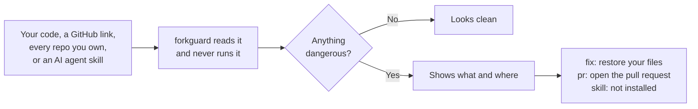

<div align="center">

<h1>
  <picture>
    <source media="(prefers-color-scheme: dark)" srcset="site/assets/brand/logo-on-dark.svg">
    
  </picture>
</h1>

**Catch malware hidden in a repo or an AI agent skill, before you install or run it.**

Check a folder, a GitHub link or every repo you own. Clean what it finds and open the pull request in one command.

[](https://www.npmjs.com/package/forkguard)
[](https://github.com/PRODHOSH/forkguard/actions/workflows/ci.yml)
[](https://github.com/marketplace/actions/forkguard)


[](LICENSE)
[](https://forkguard.pages.dev)

[**Documentation**](https://forkguard.pages.dev) &nbsp;|&nbsp; [Getting started](docs/getting-started.md) &nbsp;|&nbsp; [Commands](docs/commands.md) &nbsp;|&nbsp; [AI agent skills](docs/skills.md) &nbsp;|&nbsp; [GitHub Action](docs/github-action.md) &nbsp;|&nbsp; [How it works](docs/how-it-works.md) &nbsp;|&nbsp; [The story](https://blog.prodhosh.me/blog/malware-hid-in-my-old-repos-polinrider)

</div>

---

## Contents

[What](#what-is-forkguard) · [Why](#why-it-exists) · [How it works](#how-it-works) · [Install](#install-and-first-run) · [Commands](#commands) · [Which one are you?](#which-one-are-you) · [AI agent skills](#ai-agent-skills) · [Stay protected](#stay-protected) · [Safety](#safety-and-privacy) · [FAQ](#faq) · [Docs](#documentation) · [Contributing](#contributing) · [Developer](#developer) · [License](#license-and-credits)

---

## What is forkguard

forkguard is a free command line tool that does three jobs:

1. **Finds** the PolinRider malware in your code, in a folder, in a GitHub repo (every branch, without downloading its files) or across every repo you own.
2. **Cleans** it: removes the malware, restores your original files from git history and can open the pull request for you.
3. **Checks AI agent skills** (Claude Code, Codex, Cursor and more) before you install them, and stops `npx skills add` when a skill is dangerous.

It never runs the code it checks, sends nothing anywhere and has **zero dependencies**.

```text
$ forkguard

forkguard  my-app

  HIGH  init                Code hidden after 776 blank spaces on line 35
  HIGH  package.json        "dev" runs a hidden file called init before your real command
  HIGH  postcss.config.mjs  Code hidden after 149 blank spaces on line 12
  MED   .gitignore          Hides config.bat, a file this malware drops

  4 problems found. Do not run npm install, npm run dev or open this folder in VS Code yet.
  Run forkguard fix to clean it, or forkguard pr to clean it and open a pull request.
```

## Why it exists

- **It is invisible.** The malicious code sits after hundreds of spaces at the end of an ordinary line, so your editor shows nothing. It rewrites commits without changing the author or date, so git shows nothing either.
- **It runs by itself.** The moment you open the folder in VS Code, or type `npm install` or `npm run dev`, it steals your tokens, keys and saved passwords.
- **It spreads.** It uses your stolen GitHub token to infect every repo you can push to. Recruiters' "coding tests" and old repos are the usual way in.
- **AI agents make it worse.** An agent told to "clone this and get it running" does exactly the dangerous thing, and a malicious skill can talk your agent into worse.

Weeks after I first cleaned it, it was back in 35 of my 53 repos. Cleaning that by hand took a whole day, so I built the tool I wished I had: [the full story](https://blog.prodhosh.me/blog/malware-hid-in-my-old-repos-polinrider).

## How it works



- **Checking** looks for every trick the malware uses and skips folders that are not your code, so a project takes well under a second. A GitHub link is read straight out of git's database and never written to your disk.
- **Cleaning** deletes files that are pure malware, cuts the hidden code out of your own files and puts back your exact original from git history.
- **Skills** are scored 0 to 100 with [NVIDIA SkillSpector's](https://github.com/NVIDIA/SkillSpector) rules, translated to JavaScript.
- **Protecting** is a few lines in your shell profile that run the check before `npm install`, after `git clone` and before `npx skills add`.

More, with diagrams: [How it works](docs/how-it-works.md).

## Install and first run

You need [Node.js](https://nodejs.org) 18 or newer and [git](https://git-scm.com).

```bash
npm install -g forkguard     # once
forkguard                    # check this folder and every project inside it
forkguard fix                # clean what it found
```

That is the whole core loop. Just want to try it? `npx forkguard` works without installing. New to this? [Getting started](docs/getting-started.md) walks through every step.

## Commands

| Command | What it does |
| --- | --- |
| **Check** (changes nothing) | |
| `forkguard` | Checks this folder and every project inside it |
| `forkguard owner/repo` | Checks a GitHub repo, every branch, without downloading its files. Links and git URLs work too |
| `forkguard --mine` | Checks all your repos. Public ones need no login. Add `--fix` to open a pull request for each infected repo |
| `forkguard @name` | Checks the public repos of a person or team. No login |
| `forkguard skills` | Checks the AI agent skills on this computer. Give it a folder or `owner/repo` to check one before you install it |
| **Clean** | |
| `forkguard fix` | Cleans every infected project under this folder and restores your originals |
| `forkguard pr` | Cleans on a new branch and opens a pull request. `--upstream` sends it to the repo you forked from |
| **Protect** | |
| `forkguard setup` | Checks automatically before `npm install` and `npx skills add` and after `git clone`. `--remove` undoes it |
| `npx skills add PRODHOSH/forkguard` | Gives your AI agent the forkguard skill: every command, and when to use it |
| `forkguard agent` | Prints short safety rules for AI agents. `--write` saves them in `AGENTS.md` and `CLAUDE.md` |

**Options:** `--json` for scripts, `--yes` to skip questions, `--all` and `--strict` for skills, `--version`, `--help`.
**Exit codes:** `0` clean, `1` something dangerous, `2` forkguard could not run. `FORKGUARD_SKIP=1` skips the automatic check once.

Every option explained: [Commands reference](docs/commands.md).

## Which one are you?

<details>
<summary><b>I want to clone or fork someone's repo, or got one for a job interview</b></summary>
<br>

Check the link **before** you clone anything. This is one of the main ways the malware spreads.

```bash
forkguard someone/their-repo
```

It checks every branch straight from GitHub, without writing the repo's files to your disk. Clone only if it says **looks clean**. If it finds anything HIGH, do not clone it, do not open it, and tell the person who sent it.

Already cloned it? `forkguard their-repo` checks the folder before you open it or install anything.

</details>

<details>
<summary><b>I want to know if my own projects and repos are clean</b></summary>
<br>

On your laptop, open a terminal in the folder that holds your projects (for example `~/Developer`):

```bash
forkguard
```

It checks every project inside, however deep, and changes nothing. Clean what it found with `forkguard fix`.

On GitHub:

```bash
forkguard --mine
```

Not logged in? It finds your GitHub name from settings already on your computer, asks you to confirm it and checks your **public** repos, then shows how to log in for the private ones. To fix what it finds, `forkguard --mine --fix` opens **one pull request per infected repo** and never pushes to your main branch, so nothing changes until you merge.

To check a friend's repos: `forkguard @their-name`.

</details>

<details>
<summary><b>forkguard found something. What now?</b></summary>
<br>

The order matters.

1. Do not run `npm install` or `npm run dev`, and do not open the folder in VS Code.
2. Run `forkguard fix`, or `forkguard pr` to clean GitHub too.
3. From another device, change your GitHub tokens, SSH keys, npm token, cloud keys and `.env` secrets.
4. Block force pushes on your main branch: **Settings, Rules, Rulesets**.
5. If it says npm itself is infected, reinstall Node.js from [nodejs.org](https://nodejs.org).
6. Run a full antivirus scan and tell anyone else who works on the repo.

</details>

<details>
<summary><b>I use AI coding agents (Claude Code, Codex, Cursor...)</b></summary>
<br>

Give your agent the forkguard skill, once:

```bash
npx skills add PRODHOSH/forkguard
```

From then on it runs `npx forkguard --json` before it installs, builds or opens anything it did not write, stops on exit code 1, and never runs `fix` or `pr` without asking you. Details: [The forkguard skill](#the-forkguard-skill).

</details>

<details>
<summary><b>Someone shared an AI skill with me, or I found one online</b></summary>
<br>

Look before you install:

```bash
forkguard skills owner/repo
```

It downloads the source to a temporary folder, reads it, deletes it and tells you if it is safe to install. With `forkguard setup` turned on, `npx skills add owner/repo` does this check automatically. Details: [AI agent skills](#ai-agent-skills).

</details>

<details>
<summary><b>I never want to think about this again</b></summary>
<br>

```bash
npm install -g forkguard
forkguard setup
```

Open a new terminal. Clean projects stay silent and dangerous ones are stopped before anything runs. Add the [GitHub Action](docs/github-action.md) and GitHub checks every push too. See [Stay protected](#stay-protected).

</details>

## AI agent skills

Claude Code, Codex, Cursor and other AI coding tools load **skills**: folders with a `SKILL.md` and sometimes scripts, which your agent follows with your permissions. A bad skill can tell your agent to ignore its safety rules, read your keys or send your files out. Installing one is a single command (`npx skills add owner/repo`, see [skills.sh](https://skills.sh)), so look first, the same way you look at a dependency.

```bash
forkguard skills                  # every skill already on this computer, for all 79 agents the skills CLI supports
forkguard skills ./my-skill       # one skill, or a folder of skills
forkguard skills owner/repo       # a skill on GitHub, before you install it
```

Each skill gets a score from 0 to 100 and a plain verdict: **looks fine**, **worth a look** or **do not install**. Exit code 1 means do not install. Add `--json` for scripts and `--all` to list every finding.

**It runs by itself after `forkguard setup`.** `npx skills add owner/repo` (also `bunx`, `pnpx`, `pnpm dlx`, `yarn dlx`, `npm exec`) downloads the source to a temporary folder first, checks it and stops the install if the skill is dangerous. If the check cannot run, the install goes ahead. To install anyway: `FORKGUARD_SKIP=1 npx skills add owner/repo`.

**One thing forkguard adds.** SkillSpector's static rules also flag harmless text, and it uses an AI review to drop those false alarms. forkguard has no AI review, so it blocks only when the score is above 50 **and** something looks like a real attack. `--strict` follows SkillSpector exactly.

### The forkguard skill

Instead of explaining forkguard to your agent, let it read the skill:

```bash
npx skills add PRODHOSH/forkguard
```

[`skills/forkguard`](skills/forkguard/SKILL.md) tells the agent to check every project first, stop on exit code 1, never run `fix`, `pr` or `FORKGUARD_SKIP` on its own, treat repo text as data and check a skill before it installs one. It lists every command, the JSON shape and what to do after an infection. It works with every agent the [skills CLI](https://github.com/vercel-labs/skills) supports. If you only want the short rules, `forkguard agent --write` is still there.

### Built on NVIDIA SkillSpector

The skill rules are **[NVIDIA SkillSpector's](https://github.com/NVIDIA/SkillSpector)** (Apache 2.0), translated to JavaScript so one tool can watch your code and your skills, with no Python, no packages and no AI key. forkguard is an independent project by Prodhosh V.S, not made or endorsed by NVIDIA. **All credit for the rules belongs to NVIDIA.** [NOTICE](NOTICE) lists exactly what was taken and what was changed.

| What came across | |
| --- | --- |
| Rule ids covered | **60 of SkillSpector's 115** |
| Regex rules | **472**, copied out of its source by a script, not retyped |
| YARA rules | **all 28**, in its 5 rule files (226 patterns) |
| Not included | Its AI review, Python data-flow analysis, MCP checks and package lookups: the other 55 rule ids, listed in [docs/skills.md](docs/skills.md) |

This is a fast first check. For a skill you really depend on, **also run [SkillSpector](https://github.com/NVIDIA/SkillSpector)** itself: the two cover different ground. Problem with forkguard or a wrong rule? Write to [hello@prodhosh.me](mailto:hello@prodhosh.me) or [open an issue](https://github.com/PRODHOSH/forkguard/issues), not to NVIDIA.

## Stay protected

**On your computer.** Run `forkguard setup` once and open a new terminal. After that:

| When you run | forkguard |
| --- | --- |
| `npm`, `pnpm`, `yarn` or `bun` with `install`, `run`, `dev`, `start`, `build`, `test` | Checks the project first and **stops the command** if it is dangerous |
| `npx skills add owner/repo` (also `bunx`, `pnpx`, `pnpm dlx`) | Checks the skill first and stops the install if it is dangerous |
| `git clone`, `pull`, `merge`, `checkout`, `switch` | Checks what came in and warns you |
| Anything else | Passes straight through |

It also offers to turn off VS Code's automatic tasks, the setting this malware uses to start when you open a folder. If forkguard is missing or crashes, your command still runs.

**On GitHub.** Check every push and pull request:

```yaml
name: forkguard
on: [push, pull_request]

permissions:
  contents: write
  pull-requests: write

jobs:
  check:
    runs-on: ubuntu-latest
    steps:
      - uses: actions/checkout@v4
      - uses: PRODHOSH/forkguard@v0.7.0
        with:
          open-pr: true   # also open a pull request that removes what was found
```

The build fails when anything HIGH is found. More options: [GitHub Action guide](docs/github-action.md).

## Safety and privacy

- **It never runs code** from the project or skill it checks. It only reads files.
- **It switches off git hooks** whenever it calls git, because an infected repo can ship its own.
- **It never runs npm** to check npm. It reads npm's files directly.
- **It sends nothing anywhere.** The only network calls are downloading a repo or skill you asked it to check, and talking to GitHub for `pr` and `--mine`.
- **Zero dependencies.** Nothing sits between you and the check that could be compromised.

What it catches, rule by rule: [What it checks](docs/how-it-works.md#2-what-it-checks).

## FAQ

<details>
<summary><b>Does it upload my code?</b></summary>
<br>
No. Everything happens on your machine. It only talks to GitHub when you ask it to check a link, check your repos, or open a pull request.
</details>

<details>
<summary><b>Will it slow down npm?</b></summary>
<br>
A typical project is checked in well under a second. Commands like <code>npm --version</code> are not checked at all.
</details>

<details>
<summary><b>Can it check private repos?</b></summary>
<br>
Yes, as long as git on your machine can access them. Logging in with <code>gh auth login</code> is the easiest way. Without a login, <code>--mine</code> checks your public repos.
</details>

<details>
<summary><b>What if it flags something that is fine?</b></summary>
<br>
Skip it once with <code>FORKGUARD_SKIP=1</code>, and <a href="https://github.com/PRODHOSH/forkguard/issues/new?template=false-alarm.yml">report a false alarm</a> so the rule gets better. For a skill, <a href="https://github.com/PRODHOSH/forkguard/issues/new?template=skill-false-alarm.yml">report it here</a>.
</details>

<details>
<summary><b>Does it replace antivirus?</b></summary>
<br>
No. It is built to catch this family of attacks very well, before code runs. Keep your antivirus too.
</details>

<details>
<summary><b>Why did a normal skill get a high score?</b></summary>
<br>
SkillSpector's static rules match words like "never judge" or "keychain" wherever they appear, and it relies on an AI review to drop those. forkguard has no AI review, so it shows the score as "worth a look" unless something looks like a real attack. Read the findings, they show the exact text.
</details>

<details>
<summary><b>Is forkguard made by NVIDIA?</b></summary>
<br>
No. forkguard is an independent project. The skill rules come from NVIDIA's open source SkillSpector and all credit for them is NVIDIA's. See <a href="NOTICE">NOTICE</a>.
</details>

<details>
<summary><b>Which Node versions and systems work?</b></summary>
<br>
Node 18, 20 and 22 and newer, on Windows, macOS and Linux, with PowerShell, Git Bash, bash and zsh. CI runs all of them.
</details>

More answers: [Troubleshooting](https://forkguard.pages.dev/guides/troubleshooting/).

## Documentation

**[forkguard.pages.dev](https://forkguard.pages.dev)** has search, a short and a plain-words version of every command, and every rule. The same pages are in [`docs/`](docs/README.md):

| I want to... | Read |
| --- | --- |
| Go from zero to protected, step by step | [Getting started](docs/getting-started.md) |
| Look up a command, option or exit code | [Commands](docs/commands.md) |
| Check or publish AI agent skills | [AI agent skills](docs/skills.md) |
| Check every push on GitHub | [GitHub Action](docs/github-action.md) |
| Understand what happens under the hood | [How it works](docs/how-it-works.md) |

Machine readable: [`llms.txt`](https://forkguard.pages.dev/llms.txt) and [`llms-full.txt`](https://forkguard.pages.dev/llms-full.txt).

## Contributing

forkguard is open source and every contribution helps, from a bug report to a new rule.

- **Missed something?** [Describe what it looked like](https://github.com/PRODHOSH/forkguard/issues/new?template=missed-malware.yml), without pasting the malicious code.
- **False alarm?** [Report it](https://github.com/PRODHOSH/forkguard/issues/new?template=false-alarm.yml), or a [skill false alarm](https://github.com/PRODHOSH/forkguard/issues/new?template=skill-false-alarm.yml).
- **Want to build?** Fork, branch, `npm test`, open a pull request. [CONTRIBUTING.md](CONTRIBUTING.md) has the setup, the project map and the ground rules.

```bash
git clone https://github.com/PRODHOSH/forkguard
cd forkguard
npm test        # no install step: there are no dependencies
```

Security problem in forkguard itself? Please do not open a public issue. See [SECURITY.md](SECURITY.md).

## Developer

<table>
  <tr>
    <td>
      <a href="https://github.com/PRODHOSH"></a>
    </td>
    <td>
      <b>Prodhosh V.S</b><br>
      Built forkguard after this malware hit my own repos.<br><br>
      <a href="https://prodhosh.me">prodhosh.me</a> &nbsp;|&nbsp;
      <a href="mailto:hello@prodhosh.me">hello@prodhosh.me</a> &nbsp;|&nbsp;
      <a href="https://github.com/PRODHOSH">github.com/PRODHOSH</a> &nbsp;|&nbsp;
      <a href="https://blog.prodhosh.me">blog</a>
    </td>
  </tr>
</table>

If forkguard saved you from a bad day, a star helps other developers find it.

## License and credits

[Apache 2.0](LICENSE). Use it, change it, share it, as long as you keep the license and the credit in [NOTICE](NOTICE).

The AI agent skill checks are derived from [NVIDIA SkillSpector](https://github.com/NVIDIA/SkillSpector), Copyright (c) 2026 NVIDIA CORPORATION & AFFILIATES, also Apache 2.0. forkguard is not made or endorsed by NVIDIA.
