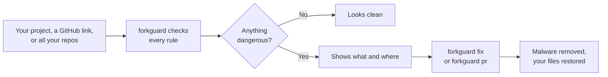

<div align="center">

# forkguard

**Catch malware hidden in a repo before you install or run it.**

Check a folder, a GitHub link, or every repo you own. Clean what it finds and open a pull request in one command.

[](https://www.npmjs.com/package/forkguard)
[](https://github.com/PRODHOSH/forkguard/actions/workflows/ci.yml)
[](https://github.com/marketplace/actions/forkguard)


[](LICENSE)

[Getting started](docs/getting-started.md) &nbsp;|&nbsp; [Commands](docs/commands.md) &nbsp;|&nbsp; [GitHub Action](docs/github-action.md) &nbsp;|&nbsp; [How it works](docs/how-it-works.md) &nbsp;|&nbsp; [The story](https://blog.prodhosh.me/blog/malware-hid-in-my-old-repos-polinrider)

</div>

---

## Contents

- [What is forkguard](#what-is-forkguard)
- [Features](#features)
- [Quick start](#quick-start)
- [Commands](#commands)
- [Which one are you?](#which-one-are-you)
- [What it catches](#what-it-catches)
- [Automatic protection](#automatic-protection)
- [GitHub Action](#github-action)
- [How it works](#how-it-works)
- [Safety and privacy](#safety-and-privacy)
- [Why I built this](#why-i-built-this)
- [FAQ](#faq)
- [Contributing](#contributing)
- [Developer](#developer)

---

## What is forkguard

Some malware hides inside ordinary looking GitHub repos. It sits after hundreds of spaces at the end of a normal line, so your editor shows nothing. It rewrites commits without changing the author or date, so git shows nothing either. The moment you open the folder in VS Code or type `npm install` or `npm run dev`, it runs, steals your tokens, keys and saved passwords, and spreads to every repo you can push to.

forkguard finds it **before** any of that happens, and cleans it up for you.

```text
$ forkguard

forkguard  my-app

  HIGH  init                Code hidden after 776 blank spaces on line 35
  HIGH  package.json        "dev" runs a hidden file called init before your real command
  HIGH  postcss.config.mjs  Code hidden after 149 blank spaces on line 12
  MED   .gitignore          Hides config.bat, a file this malware drops

  4 problems found. Do not run npm install, npm run dev or open this folder in VS Code yet.
  Run forkguard fix to clean it, or forkguard pr to clean it and open a pull request.
```

## Features

| | |
| --- | --- |
| **Check a folder** | Scans a project in well under a second |
| **Check a GitHub link** | Checks every branch of any repo without writing its files to your disk |
| **Check all your repos** | One command checks every repo you own on GitHub |
| **Clean it** | Removes the malware and restores your original files from git history |
| **Open a pull request** | Cleans a repo on a new branch, pushes it and opens the pull request for you |
| **Automatic protection** | Stops `npm install` and `npm run dev` on infected projects, warns after `git clone` |
| **GitHub Action** | Fails the build when malware lands, and can open the fix as a pull request |
| **Checks npm itself** | Spots an infected npm on your computer, which would reinfect you after every cleanup |
| **Zero dependencies** | Nothing extra is installed, so nothing extra can be compromised |
| **Cross platform** | Windows, macOS and Linux, with PowerShell, Git Bash, bash and zsh |

## Quick start

You need [Node.js](https://nodejs.org) 18 or newer and [git](https://git-scm.com).

**1. Install it**

```bash
npm install -g forkguard
```

**2. Check the project you are in**

```bash
forkguard
```

**3. Turn on automatic protection, once**

```bash
forkguard setup
```

Open a new terminal and you are protected from then on. Just want to try it without installing? Run `npx forkguard`.

New to all this? The [Getting started guide](docs/getting-started.md) walks you through every step.

## Commands

### Check

| Command | What it does |
| --- | --- |
| `forkguard` | Checks the folder you are in |
| `forkguard path/to/folder` | Checks another folder |
| `forkguard owner/repo` | Checks a GitHub repo, every branch, without downloading its files |
| `forkguard https://github.com/owner/repo` | Same, with a full link |
| `forkguard --mine` | Checks every repo you own on GitHub |

### Clean

| Command | What it does |
| --- | --- |
| `forkguard fix` | Cleans the folder you are in |
| `forkguard pr` | Cleans it on a new branch, pushes it and opens a pull request on your repo |
| `forkguard pr --upstream` | Sends the fix as a pull request to the repo you forked from |

### Protect

| Command | What it does |
| --- | --- |
| `forkguard setup` | Turns on automatic checks for npm, pnpm, yarn, bun and git |
| `forkguard setup --remove` | Turns them off |

### Extras

| Option | What it does |
| --- | --- |
| `--json` | Prints the results as JSON, for scripts |
| `--version` | Shows the version |
| `--help` | Shows all commands |
| `FORKGUARD_SKIP=1` | Skips the automatic check once |

Every command, option and exit code is explained in detail in the [Commands reference](docs/commands.md).

## Which one are you?

Click your situation.

<details>
<summary><b>I want to fork or clone someone's repo. Is it safe?</b></summary>
<br>

Check the link **before** you clone it:

```bash
forkguard someone/their-repo
```

forkguard checks every branch straight from GitHub without writing any of the repo's files to your disk. Clone it only if it says **looks clean**.

Already cloned it? Check the folder before you open it in VS Code or install anything:

```bash
forkguard their-repo
```

</details>

<details>
<summary><b>Is my own repo clean?</b></summary>
<br>

On your laptop, pull first, because the malware gets into GitHub, not your laptop:

```bash
cd my-repo
git pull
forkguard
```

Or check it straight on GitHub, every branch:

```bash
forkguard your-name/my-repo
```

If something is found, `forkguard fix` cleans your copy and `forkguard pr` cleans GitHub too.

</details>

<details>
<summary><b>Are all my repos clean?</b></summary>
<br>

Log in to the GitHub CLI once, then check everything you own:

```bash
gh auth login
```

```bash
forkguard --mine
```

You get one line per repo, then the details for anything that needs a look.

</details>

<details>
<summary><b>Someone sent me a repo for a job interview or coding test</b></summary>
<br>

This is one of the main ways this malware spreads. Check the link first, before you clone or open anything:

```bash
forkguard https://github.com/someone/coding-test
```

If it finds anything HIGH, do not clone it, do not open it and do not run it. Tell the person who sent it.

</details>

<details>
<summary><b>I never want to think about this again</b></summary>
<br>

```bash
npm install -g forkguard
```

```bash
forkguard setup
```

Open a new terminal. From now on forkguard checks every project before `npm install` or `npm run dev`, and right after every `git clone` or `git pull`. Clean projects stay silent. Dangerous ones are stopped before anything runs.

Add the [GitHub Action](#github-action) to your repos and GitHub checks every push for you too.

</details>

<details>
<summary><b>forkguard found something. What now?</b></summary>
<br>

The order matters.

1. Do not run `npm install` or `npm run dev`, and do not open the folder in VS Code.
2. Run `forkguard fix`, or `forkguard pr` to clean GitHub too.
3. From another device, change your GitHub tokens, SSH keys, npm token, cloud keys and `.env` secrets.
4. Block force pushes on your main branch: **Settings**, then **Rules**, then **Rulesets**.
5. If forkguard says npm itself is infected, reinstall Node.js from [nodejs.org](https://nodejs.org).
6. Run a full antivirus scan, and tell anyone else who works on the repo.

</details>

## What it catches

Every rule comes from real infected repos.

| Check | What it means | Level |
| --- | --- | --- |
| Hidden code | Code pushed far to the right after a long run of spaces, in any JS or TS file | HIGH |
| Known signatures | Strings that only show up in this malware | HIGH |
| `node init` scripts | `dev`, `build` or `start` secretly run a file called `init` first | HIGH |
| Fake fonts | A `.ttf` or `.woff2` file that is really JavaScript | HIGH |
| Decoy folders | A fonts folder planted to make the fake font look normal | HIGH |
| VS Code auto tasks | A task that runs the moment you open the folder | HIGH |
| Dropped files | `config.bat`, `temp_auto_push.bat`, `.orc` files | HIGH |
| Bad packages | npm packages known to carry this malware | HIGH |
| Infected npm | npm's own `cli.js` on your computer bloated with hidden code | HIGH |
| Injected require lines | Fake `createRequire` lines added to config files | MED |
| Auto task setting | VS Code settings that switch automatic tasks on | MED |
| `.gitignore` tricks | Hiding the dropped `config.bat` | MED |
| Unprotected `.env` | A `.env` that git is not ignoring, or one that is committed | MED |
| Risky install scripts | `postinstall` and friends that download or decode things | MED |
| Rewritten commit | The latest commit has the same time in a different timezone | MED |

**HIGH** means it can run by itself and steal from you. **MED** means it is worth a look but does not run by itself.

## Automatic protection

After `forkguard setup`, in every new terminal:

| When you run | forkguard |
| --- | --- |
| `npm install`, `npm run dev`, `npm start`, `npm test`, `npm run build` | Checks first and **stops the command** if the project is dangerous |
| The same with `pnpm`, `yarn` or `bun` | Does the same |
| `git clone`, `git pull`, `git merge`, `git checkout`, `git switch` | Checks what you just pulled in and warns you |
| Anything else, like `npm --version` or `git status` | Passes straight through |

It also offers to turn off automatic tasks in VS Code, the setting this malware uses to start the moment you open a folder.

Clean projects stay silent. Skip the check once with `FORKGUARD_SKIP=1 npm install`, or in PowerShell `$env:FORKGUARD_SKIP='1'; npm install`. Undo everything with `forkguard setup --remove`.

## GitHub Action

Check every push and pull request on GitHub:

```yaml
name: forkguard
on: [push, pull_request]

permissions:
  contents: write
  pull-requests: write

jobs:
  check:
    runs-on: ubuntu-latest
    steps:
      - uses: actions/checkout@v4
      - uses: PRODHOSH/forkguard@v0.3.1
        with:
          open-pr: true
```

| Input | Default | What it does |
| --- | --- | --- |
| `path` | `.` | Folder to check |
| `open-pr` | `false` | Also open a pull request that removes what was found |

The build fails when anything HIGH is found. See the [GitHub Action guide](docs/github-action.md) for every option.

## How it works



- **Checking** reads files and looks for every trick in the table above. It skips `node_modules`, build output and other folders that are not your code.
- **Checking a link** downloads only the latest commit of each branch into a temporary folder, reads the files straight from git's database without writing them out, then deletes the download.
- **Fixing** deletes files that are pure malware, cuts the hidden code out of your own files, and restores your exact original from git history when it can.
- **Pull requests** are built on a fresh branch, so your work in progress is never touched.

The full picture, with diagrams of every part, is in [How it works](docs/how-it-works.md).

## Safety and privacy

- **It never runs code** from the project it checks. It only reads files.
- **It switches off git hooks** every time it calls git, since an infected repo can ship its own.
- **It never runs npm** to check npm. It reads npm's files directly.
- **It sends nothing anywhere.** The only network calls are downloading a repo you asked it to check, and talking to GitHub when you run `forkguard pr` or `--mine`.
- **Zero dependencies.** There is nothing between you and the check that could be compromised.

## Why I built this

It started with emails from Vercel. Production builds were failing on old projects I had not touched in months, all with the same useless message: `npm run build exited with 1`.

I opened `postcss.config.mjs` in one of them and scrolled right. After `export default config;` there were hundreds of spaces, then a block of scrambled JavaScript. Git showed nothing. Same author, same date, same message.

It is a malware campaign researchers call **PolinRider**. It has reached thousands of repos. Weeks after I first found it, it was back in 35 of my 53 repos. Cleaning that by hand without losing real work took a whole day. forkguard is the tool I wish I had on the first day.

Full story: **[Malware Hid in My Old Repos and Git Never Showed It](https://blog.prodhosh.me/blog/malware-hid-in-my-old-repos-polinrider)**

## FAQ

<details>
<summary><b>Does it upload my code?</b></summary>
<br>
No. Everything happens on your machine. It only talks to GitHub when you ask it to check a link, check your repos, or open a pull request.
</details>

<details>
<summary><b>Will it slow down npm?</b></summary>
<br>
A typical project is checked in well under a second. Commands like <code>npm --version</code> are not checked at all.
</details>

<details>
<summary><b>Can it check private repos?</b></summary>
<br>
Yes, as long as git on your machine can access them. Logging in with <code>gh auth login</code> is the easiest way.
</details>

<details>
<summary><b>What if it flags something that is fine?</b></summary>
<br>
Skip it once with <code>FORKGUARD_SKIP=1</code>, and <a href="https://github.com/PRODHOSH/forkguard/issues/new?template=false-alarm.yml">report a false alarm</a> so the rule gets better.
</details>

<details>
<summary><b>Does it replace antivirus?</b></summary>
<br>
No. It is built to catch this family of attacks very well, before code runs. Keep your antivirus too.
</details>

More questions are answered in the [Getting started guide](docs/getting-started.md#12-troubleshooting).

## Contributing

forkguard is open source and contributions are welcome.

- Found something it misses? [Tell us what it looked like](https://github.com/PRODHOSH/forkguard/issues/new?template=missed-malware.yml), without pasting the malicious code.
- Got a false alarm? [Report it](https://github.com/PRODHOSH/forkguard/issues/new?template=false-alarm.yml).
- Want to help build it? Read [CONTRIBUTING.md](CONTRIBUTING.md).

```bash
git clone https://github.com/PRODHOSH/forkguard
cd forkguard
npm test
```

Security problem in forkguard itself? See [SECURITY.md](SECURITY.md).

## Developer

<table>
  <tr>
    <td>
      <a href="https://github.com/PRODHOSH"></a>
    </td>
    <td>
      <b>Prodhosh V.S</b><br>
      Built forkguard after this malware hit my own repos.<br><br>
      <a href="https://prodhosh.me">prodhosh.me</a> &nbsp;|&nbsp;
      <a href="mailto:hello@prodhosh.me">hello@prodhosh.me</a> &nbsp;|&nbsp;
      <a href="https://github.com/PRODHOSH">github.com/PRODHOSH</a>
    </td>
  </tr>
</table>

If forkguard saved you from a bad day, a star helps other developers find it.

## License

[MIT](LICENSE). Use it, change it, share it.
