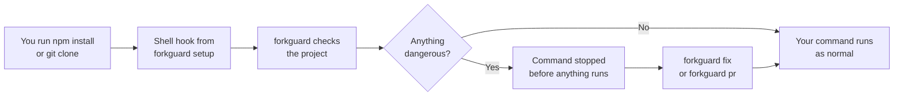
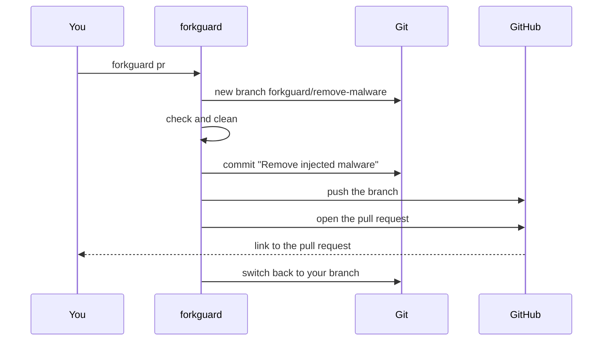
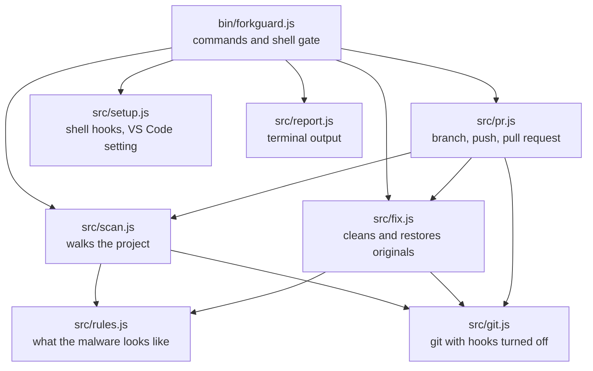

<div align="center">

# forkguard

**Catch malware hidden in a repo before you install or run it.**

Then clean it up and open a pull request, in one command.

[](https://github.com/PRODHOSH/forkguard/actions/workflows/ci.yml)


</div>

```text
$ npx forkguard

forkguard  my-app

  HIGH  init                Code hidden after 776 blank spaces on line 35
  HIGH  package.json        "dev" runs a hidden file called init before your real command
  HIGH  postcss.config.mjs  Code hidden after 149 blank spaces on line 12
  MED   .gitignore          Hides config.bat, a file this malware drops

  4 problems found. Do not run npm install, npm run dev or open this folder in VS Code yet.
  Run forkguard fix to clean it, or forkguard pr to clean it and open a pull request.
```

## Why this exists

In November 2026 I found malware sitting in 35 of my own GitHub repos. I never wrote it and never saw it go in.

It is a campaign security researchers call PolinRider. It works like this:

1. It gets onto one developer's laptop, usually through a poisoned npm package or a fake "coding test" from a recruiter.
2. It steals that developer's GitHub token.
3. It uses the token to quietly rewrite the **latest commit** in every repo the token can push to. Same author, same time, same message. The commit just has extra files in it now.
4. The next person who clones the repo and opens it in VS Code, or runs `npm install` or `npm run dev`, runs the malware too. Then it spreads from their machine.

The scary part is how well it hides. The code sits after hundreds of spaces at the end of a normal line like `export default config;`, so your editor shows nothing. There is a "font" file that is really JavaScript. There is a VS Code task that runs the moment you open the folder. Your git history looks untouched.

Antivirus caught some of it on my machine. It did not tell me which repos were infected, what to delete, or how to fix the commits on GitHub. So I built the tool I wished I had.

I wrote up the whole story, from the first weird file to cleaning every repo, on my blog: [Malware Hid in My Old Repos and Git Never Showed It](https://blog.prodhosh.me/blog/malware-hid-in-my-old-repos-polinrider).

## What it does

- **Checks** a project for every trick this malware uses, in about a second
- **Cleans** it, and gives you back your original files byte for byte from git history when it can
- **Opens a pull request** with the fix, so you can clean a repo you forked or tell the owner
- **Runs on its own** before `npm install`, `npm run dev` and after `git clone`, if you want it to

It has zero dependencies. A security tool you run before `npm install` should not pull in 200 packages from npm first.

## Install

```bash
npm install -g forkguard
```

Or run it once without installing:

```bash
npx forkguard
```

You need Node.js 18 or newer and git.

## Usage

There are four commands. That is all of them.

| Command | What it does |
| --- | --- |
| `forkguard` | Checks the current folder. Pass a path to check another one. |
| `forkguard fix` | Removes everything it found. Review with `git diff` after. |
| `forkguard pr` | Removes it on a new branch, pushes it and opens a pull request. |
| `forkguard setup` | Makes forkguard run by itself before installs and after clones. |

A few extras when you need them:

- `forkguard pr --upstream` sends the fix to the repo you forked from instead of your fork
- `forkguard setup --remove` undoes setup
- `forkguard --json` prints findings as JSON for scripts and CI

## Set it and forget it

Run this once:

```bash
forkguard setup
```

From then on, in a new terminal:

- `npm`, `pnpm`, `yarn` and `bun` check the project before they **install, run, dev, start, build or test**. If something dangerous is there, the command is stopped before a single line of the project runs.
- `git clone`, `pull`, `merge`, `checkout` and `switch` check the code you just pulled in and warn you before you open it.
- It offers to turn off automatic VS Code tasks, which is how this malware starts the moment you open a folder.

When everything is clean you see nothing at all. It only speaks up when there is a problem.

Need to run something anyway? Skip it once:

```bash
FORKGUARD_SKIP=1 npm install
```

```powershell
$env:FORKGUARD_SKIP='1'; npm install
```

Setup works with PowerShell, Git Bash, bash and zsh. It only adds one clearly marked block to your shell profile, and `forkguard setup --remove` takes it out again.

## How it works



### What it looks for

Every rule here comes from real infected repos, not guesses.

| Check | What it means | Level |
| --- | --- | --- |
| Hidden code | Code pushed far to the right after a long run of spaces, in any JS or TS file | High |
| Known signatures | Strings that only appear in this malware's payload | High |
| `node init` scripts | `dev`, `build` or `start` secretly run a file called `init` first | High |
| Fake fonts | A `.ttf` or `.woff2` that is really JavaScript | High |
| Decoy folders | A fonts folder planted to make the fake font look normal | High |
| VS Code auto tasks | A task in `.vscode/tasks.json` that runs when you open the folder | High |
| Dropped files | `config.bat`, `temp_auto_push.bat`, `.orc` files | High |
| Bad packages | npm packages known to carry this payload, in `package.json` or lockfiles | High |
| Injected require lines | Fake `createRequire` lines added to the top of config files | Medium |
| Auto task setting | `.vscode/settings.json` turning automatic tasks on | Medium |
| `.gitignore` tricks | Hiding the dropped `config.bat` file | Medium |
| Committed secrets | A `.env` file that is tracked by git | Medium |
| Risky install scripts | `postinstall` and friends that download or decode things | Medium |
| Rewritten commit | Your latest commit has the same time in a different timezone, the fingerprint of a rewrite | Medium |

High means it can run on its own and steal from you. The exit code is 1 when anything high is found.

### How fixing works

Cutting the hidden code off is the easy part. The malware also adds fake `require` lines to the top of files, and sometimes mangles the line breaks. So forkguard does three things:

1. Deletes files that are pure malware: `init`, fake fonts, decoy folders, dropped `.bat` files, auto-run tasks.
2. Cleans files that are yours but were tampered with: it cuts the hidden tail, removes the injected lines and takes `node init &&` out of your scripts. Your own code and blank lines are left alone.
3. Looks back through git history for the last clean version of each file. If it has the same code as the cleaned result, forkguard puts back your **exact original bytes**.

It never runs anything from the project, and it turns off git hooks while it works, since an infected repo can ship its own.

### How the pull request works



By default the pull request goes to your own repo. That is always safe.

With `--upstream`, the fix is built on top of the original repo's branch, not your fork. This matters: if your fork is the infected one, a normal pull request would carry the malicious commit along with the fix. Building from upstream means the pull request holds exactly one commit, the fix.

It uses the GitHub CLI if you have it, then `GITHUB_TOKEN`, and if neither is there it gives you the link to open the pull request yourself.

## Architecture



## Tech stack

| Part | Choice | Why |
| --- | --- | --- |
| Runtime | Node.js 18+ | Every JavaScript developer already has it |
| Dependencies | None | Nothing to compromise between you and the check |
| Git access | The `git` you already have | Reads history to restore your originals |
| Pull requests | GitHub CLI or the GitHub REST API | Works with whatever you are logged in with |
| Tests | `node:test` | Built into Node, no test framework to install |
| CI | GitHub Actions on Linux, Windows and macOS | The malware targets all three |

## Use it in CI

Fail the build if a pull request or push brings malware in:

```yaml
name: forkguard
on: [push, pull_request]
permissions:
  contents: write
  pull-requests: write
jobs:
  check:
    runs-on: ubuntu-latest
    steps:
      - uses: actions/checkout@v4
      - uses: PRODHOSH/forkguard@v0.1.0
        with:
          open-pr: true
```

Leave out `open-pr` if you only want the build to fail.

## If it finds something

1. Do not run `npm install`, `npm run dev` or open the folder in VS Code.
2. Run `forkguard fix` or `forkguard pr`.
3. From another device, rotate your GitHub tokens, npm tokens, cloud keys and anything in `.env` files.
4. Turn on a rule that blocks force pushes on your default branch. In your repo go to Settings, then Rules, then Rulesets. This stops the malware from rewriting your commits again.
5. Run a full antivirus scan.

## FAQ

**Does it send my code anywhere?**
No. It reads files on your machine. The only network calls are the ones `forkguard pr` makes to GitHub when you ask it to open a pull request.

**Will it slow down npm?**
It checks a normal project in well under a second and skips `node_modules`, build output and other folders that are not your code.

**What if it flags something that is fine?**
Run `forkguard` to see why, and skip it once with `FORKGUARD_SKIP=1`. Then open an issue with the file, so the rule can get better.

**Does it catch every kind of malware?**
No. It is built to catch this family of attacks very well. It is not a replacement for antivirus.

## Contributing

Found a new trick this malware uses? Open an issue with what it looked like, without the actual payload. Pull requests with a test are very welcome.

```bash
git clone https://github.com/PRODHOSH/forkguard
cd forkguard
npm test
```

## License

MIT
