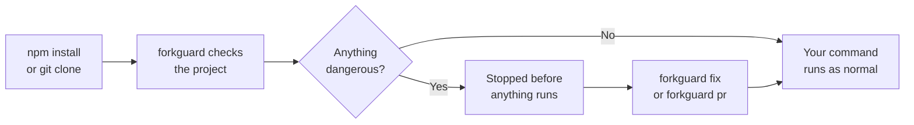
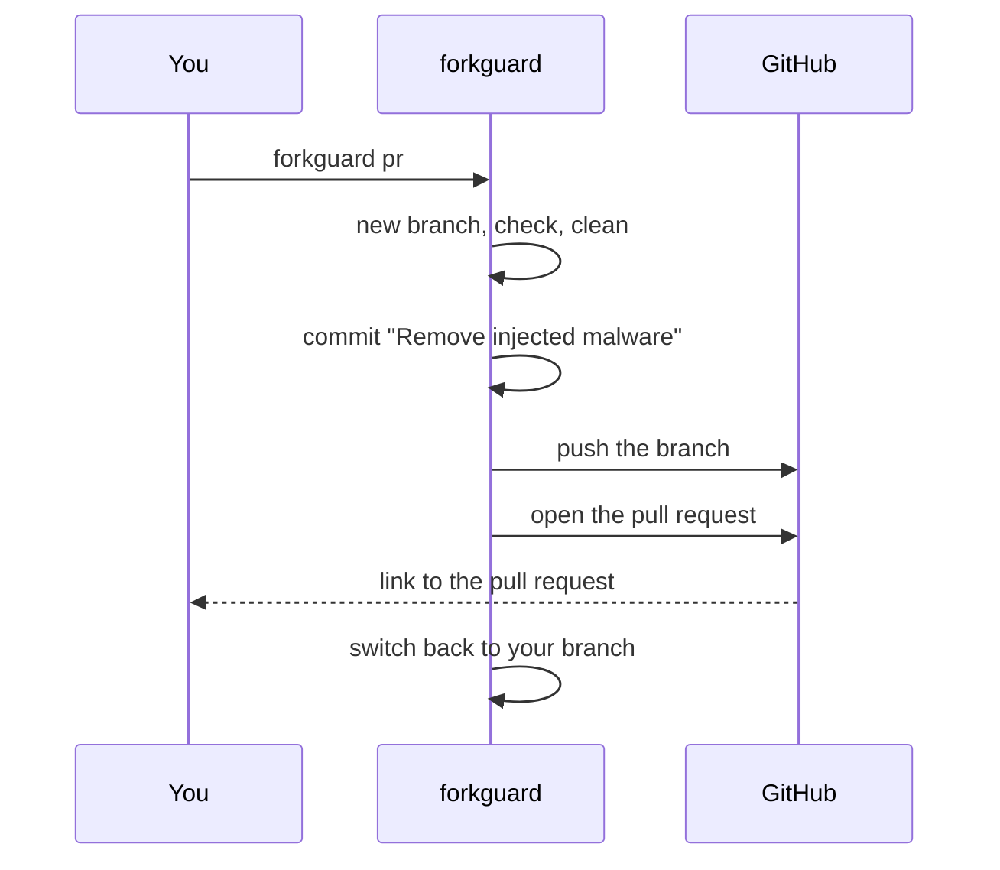
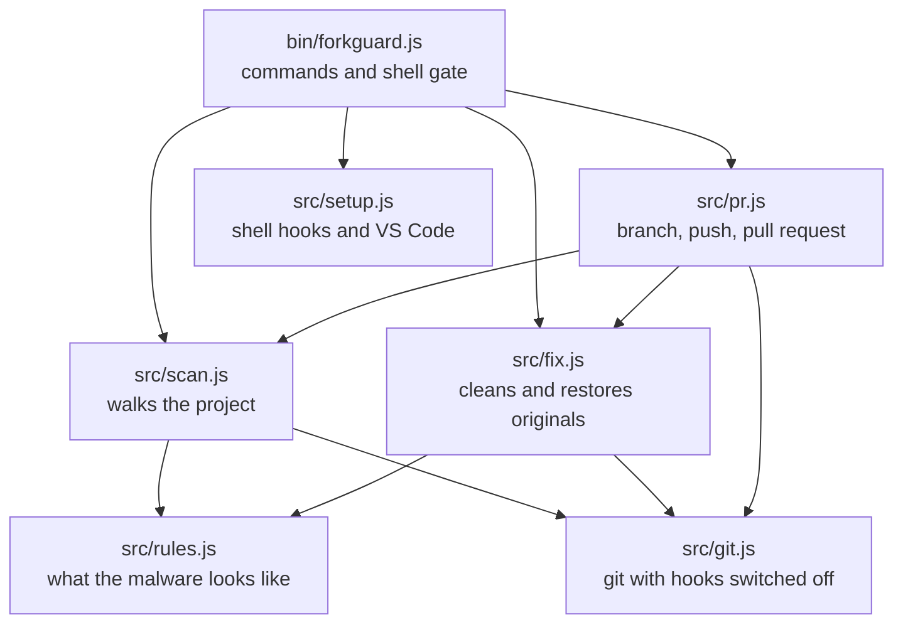

<div align="center">

# forkguard

**Catch malware hidden in a repo before you install or run it.**

Clean it up and open a pull request in one command.

[](https://www.npmjs.com/package/forkguard)
[](https://github.com/PRODHOSH/forkguard/actions/workflows/ci.yml)


[](LICENSE)

</div>

## Quick start

Check any project right now, nothing to install:

```bash
npx forkguard
```

Or install it once and let it guard every `npm install`, `npm run dev` and `git clone` for you:

```bash
npm install -g forkguard
```

```bash
forkguard setup
```

This is what it looks like when it finds something:

```text
forkguard  my-app

  HIGH  init                Code hidden after 776 blank spaces on line 35
  HIGH  package.json        "dev" runs a hidden file called init before your real command
  HIGH  postcss.config.mjs  Code hidden after 149 blank spaces on line 12
  MED   .gitignore          Hides config.bat, a file this malware drops

  4 problems found. Do not run npm install, npm run dev or open this folder in VS Code yet.
  Run forkguard fix to clean it, or forkguard pr to clean it and open a pull request.
```

When a project is clean, it says so in one line and gets out of your way.

## Why I built this

It started with emails from Vercel. Production builds were failing, but not for anything I had pushed. They were old projects I had not touched in months, ten or eleven of them, all failing with the same useless message: `npm run build exited with 1`.

I opened `postcss.config.mjs` in one of them. It looked normal. Then I scrolled right. After the last line, `export default config;`, there were hundreds of spaces, and after them a block of scrambled JavaScript. My editor showed nothing unless I scrolled sideways.

Git showed nothing either. Same author, same date, same message. As far as the history was concerned, I wrote that file and never changed it again.

It is a malware campaign researchers call **PolinRider**. It gets onto one developer's machine through a fake coding test or a poisoned npm package, steals their GitHub token, and quietly rewrites the latest commit in every repo that token can push to. The next person who opens one of those repos in VS Code or runs `npm install` gets infected too. Researchers counted more than 4,000 infected repos by mid 2026.

Weeks after I first found it, it was back. This time it was sitting in 35 of my 53 repos, hiding in config files, fake font files and VS Code tasks that run when you open a folder. It can even hide inside npm itself. Cleaning all of that by hand, carefully, without losing real work, took a whole day.

forkguard is the tool I wish I had on the first day.

I wrote the full story, with every step of how I found it and cleaned it, on my blog: **[Malware Hid in My Old Repos and Git Never Showed It](https://blog.prodhosh.me/blog/malware-hid-in-my-old-repos-polinrider)**

## Commands

There are four. That is all of them.

| Command | What it does |
| --- | --- |
| `forkguard` | Checks the current folder. Pass a path to check another one. |
| `forkguard fix` | Removes everything it found. Review it with `git diff` after. |
| `forkguard pr` | Removes it on a new branch, pushes it and opens a pull request. |
| `forkguard setup` | Runs forkguard by itself before installs and after clones. |

Optional extras:

- `forkguard pr --upstream` sends the fix to the repo you forked from
- `forkguard setup --remove` undoes setup
- `forkguard --json` prints the findings as JSON

## Automatic mode

Run `forkguard setup` once. In every new terminal after that:

- **Before** `npm`, `pnpm`, `yarn` or `bun` installs, runs, builds or tests anything, forkguard checks the project. If it finds something dangerous, the command is stopped before a single line of the project runs.
- **After** `git clone`, `pull`, `merge`, `checkout` or `switch`, it checks the code you just pulled in and warns you before you open it.
- It offers to turn off automatic VS Code tasks, which is how this malware starts the moment you open a folder.

Clean projects stay silent. You only hear from forkguard when something is wrong.

To run a command anyway, skip the check once:

```bash
FORKGUARD_SKIP=1 npm install
```

```powershell
$env:FORKGUARD_SKIP='1'; npm install
```

Works with PowerShell, Git Bash, bash and zsh. Setup adds one clearly marked block to your shell profile and `forkguard setup --remove` takes it out again.

## What it catches

Every rule comes from real infected repos, not guesses.

| Check | What it means | Level |
| --- | --- | --- |
| Hidden code | Code pushed far to the right after a long run of spaces, in any JS or TS file | High |
| Known signatures | Strings that only show up in this malware | High |
| `node init` scripts | `dev`, `build` or `start` secretly run a file called `init` first | High |
| Fake fonts | A `.ttf` or `.woff2` file that is really JavaScript | High |
| Decoy folders | A fonts folder planted to make the fake font look normal | High |
| VS Code auto tasks | A task that runs the moment you open the folder | High |
| Dropped files | `config.bat`, `temp_auto_push.bat`, `.orc` files | High |
| Bad packages | npm packages known to carry this payload, in `package.json` or lockfiles | High |
| Infected npm | npm's own `cli.js` on your computer is bloated with hidden code | High |
| Injected require lines | Fake `createRequire` lines added to the top of config files | Medium |
| Auto task setting | `.vscode/settings.json` switching automatic tasks on | Medium |
| `.gitignore` tricks | Hiding the dropped `config.bat` file | Medium |
| Unprotected `.env` | A `.env` file that git is not ignoring, or one that is already committed | Medium |
| Risky install scripts | `postinstall` and friends that download or decode things | Medium |
| Rewritten commit | Your latest commit has the same time in a different timezone | Medium |

**High** means it can run by itself and steal from you. forkguard exits with code 1 when it finds anything high, so it works in scripts and CI.

## How it works



### Fixing without losing your work

Cutting off the hidden code is the easy part. The malware also adds fake `require` lines to the top of files and sometimes mangles the line breaks. So `forkguard fix` does three things:

1. **Deletes** files that are nothing but malware: `init`, fake fonts, decoy folders, dropped `.bat` files and auto-run tasks.
2. **Cleans** files that are yours but were tampered with. It cuts the hidden tail, removes the injected lines and takes `node init &&` out of your scripts. Your own code and blank lines stay exactly as they were.
3. **Restores** your original. It looks back through git history for the last clean version of each file, and if the code matches, it puts back your exact original bytes.

It never runs anything from the project it checks, and it switches off git hooks while it works, since an infected repo can bring its own.

### Opening the pull request



By default the pull request goes to your own repo, which is always safe.

With `--upstream` the fix is built on top of the original repo you forked from. That matters: if your fork is the infected one, a normal pull request would carry the malicious commit along with the fix. Building from upstream keeps the pull request to exactly one commit, the fix.

It uses the GitHub CLI if you have it, then `GITHUB_TOKEN`, and if neither is there it prints the link so you can open the pull request yourself.

## GitHub Action

Fail the build when a push or pull request brings malware in, and optionally open a pull request that removes it:

```yaml
name: forkguard
on: [push, pull_request]

permissions:
  contents: write
  pull-requests: write

jobs:
  check:
    runs-on: ubuntu-latest
    steps:
      - uses: actions/checkout@v4
      - uses: PRODHOSH/forkguard@v0.2.0
        with:
          open-pr: true
```

| Input | Default | What it does |
| --- | --- | --- |
| `path` | `.` | Folder to check |
| `open-pr` | `false` | Open a pull request that removes what was found |

## If it finds something

The order matters.

1. Do not run `npm install` or `npm run dev`, and do not open the folder in VS Code.
2. Run `forkguard fix`, or `forkguard pr` to fix it on GitHub too.
3. From another device, rotate your GitHub tokens, SSH keys, npm token, cloud keys, deploy tokens and everything in your `.env` files.
4. Block force pushes on your default branch. In your repo go to **Settings**, then **Rules**, then **Rulesets**. The malware rewrites history with force pushes, so this stops it cold.
5. If forkguard says npm itself is infected, reinstall Node.js from [nodejs.org](https://nodejs.org).
6. Run a full antivirus scan and tell anyone who works on the same repos.

## Architecture



## Tech stack

| Part | Choice | Why |
| --- | --- | --- |
| Runtime | Node.js 18+ | Every JavaScript developer already has it |
| Dependencies | None | A tool you run before `npm install` should not need `npm install` |
| Git | The `git` you already have | Reads history to restore your original files |
| Pull requests | GitHub CLI or the GitHub API | Works with however you are logged in |
| Tests | `node:test` | Built into Node, nothing extra to install |
| CI | Linux, Windows and macOS | The malware goes after all three |

## FAQ

**Does it send my code anywhere?**
No. It reads files on your machine. The only network calls are the ones `forkguard pr` makes to GitHub, and only when you ask it to.

**Will it slow down npm?**
It checks a typical project in well under a second and skips `node_modules`, build output and other folders that are not your code.

**What if it flags something that is fine?**
Run `forkguard` to see why, skip it once with `FORKGUARD_SKIP=1`, and [open a false alarm issue](https://github.com/PRODHOSH/forkguard/issues/new?template=false-alarm.yml) so the rule gets better.

**Does it catch every kind of malware?**
No. It is built to catch this family of attacks very well. It does not replace antivirus.

## Contributing

forkguard is open source and contributions are welcome. Found a trick it misses? [Tell me what it looked like](https://github.com/PRODHOSH/forkguard/issues/new?template=missed-malware.yml), without pasting the actual malicious code. Pull requests with a test are even better. See [CONTRIBUTING.md](CONTRIBUTING.md).

```bash
git clone https://github.com/PRODHOSH/forkguard
cd forkguard
npm test
```

## Developer

<table>
  <tr>
    <td>
      <a href="https://github.com/PRODHOSH"></a>
    </td>
    <td>
      <b>Prodhosh V.S</b><br>
      Built forkguard after this malware hit my own repos.<br><br>
      <a href="https://prodhosh.me">prodhosh.me</a> &nbsp;|&nbsp;
      <a href="mailto:hello@prodhosh.me">hello@prodhosh.me</a> &nbsp;|&nbsp;
      <a href="https://github.com/PRODHOSH">github.com/PRODHOSH</a>
    </td>
  </tr>
</table>

If forkguard saved you from a bad day, a star helps other developers find it.

## License

MIT. Use it, change it, share it.
