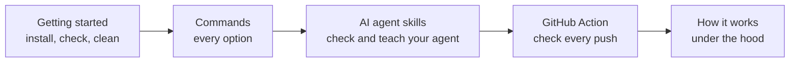

  <a href="https://github.com/PRODHOSH/forkguard">
    <picture>
      <source media="(prefers-color-scheme: dark)" srcset="../site/assets/brand/logo-on-dark.svg">
      
    </picture>
  </a>

# forkguard documentation

Everything in here is also on **[forkguard.pages.dev](https://forkguard.pages.dev)**, with search and a short and a plain-words version of every command. These files are the same pages, readable on GitHub.

## Start here

| Guide | Read it when | What is in it |
| --- | --- | --- |
| [Getting started](getting-started.md) | It is your first day | Install, check, read the results, clean, pull requests, skills, automatic protection |
| [Commands](commands.md) | You need an option, an exit code or a JSON field | Every command with its output, options, environment variables and JSON |
| [AI agent skills](skills.md) | You use Claude Code, Codex, Cursor or another agent | `forkguard skills`, the install guard, the forkguard skill, coverage and credits |
| [GitHub Action](github-action.md) | You want every push checked | Setup, inputs, nightly checks, opening the fix as a pull request |
| [How it works](how-it-works.md) | You want to know what it does and why | The attack, every rule, cleaning, pull requests, architecture |

## Find your answer fast

| I want to... | Go to |
| --- | --- |
| Check a repo before I clone it | [Getting started, section 4](getting-started.md#4-check-a-github-repo-before-you-clone-it) |
| Check all my GitHub repos | [Getting started, section 5](getting-started.md#5-check-every-repo-you-own) |
| Clean an infected project | [Getting started, section 7](getting-started.md#7-clean-a-project) |
| Check an AI skill before I install it | [AI agent skills](skills.md#check-a-skill) |
| Give my AI agent the forkguard skill | [AI agent skills](skills.md#the-forkguard-skill-for-your-agent) |
| Know what each exit code means | [Commands, exit codes](commands.md#exit-codes) |
| Use the results in a script | [Commands, JSON output](commands.md#json-output) |
| See every rule | [How it works, what it checks](how-it-works.md#2-what-it-checks) |
| Report a problem or contribute | [CONTRIBUTING.md](../CONTRIBUTING.md) |
| Report a security problem in forkguard | [SECURITY.md](../SECURITY.md) |

## Licenses and credits

forkguard is [Apache 2.0](../LICENSE). The skill checks are derived from [NVIDIA SkillSpector](https://github.com/NVIDIA/SkillSpector) (also Apache 2.0). What was taken and what was changed is in [NOTICE](../NOTICE). forkguard is an independent project by Prodhosh V.S and is not made or endorsed by NVIDIA. Questions: [hello@prodhosh.me](mailto:hello@prodhosh.me).
