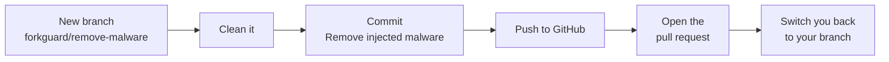

# Getting started with forkguard

This guide takes you from zero to fully protected in about five minutes. Read it top to bottom the first time, then come back to any section when you need it.

## Contents

1. [What forkguard does](#1-what-forkguard-does)
2. [Install it](#2-install-it)
3. [Check your first project](#3-check-your-first-project)
4. [Read the results](#4-read-the-results)
5. [Clean a project](#5-clean-a-project)
6. [Fix it on GitHub with a pull request](#6-fix-it-on-github-with-a-pull-request)
7. [Turn on automatic checks](#7-turn-on-automatic-checks)
8. [Use it in GitHub Actions](#8-use-it-in-github-actions)
9. [Found something? Do this next](#9-found-something-do-this-next)
10. [Troubleshooting](#10-troubleshooting)
11. [Cheat sheet](#11-cheat-sheet)

---

## 1. What forkguard does

Some malware hides inside ordinary looking repos. It runs the moment you open the folder in VS Code or type `npm install` or `npm run dev`, then steals your tokens and passwords.

forkguard looks at a project **before** any of that happens and tells you if it is safe. If it is not, it can clean it for you.

It never runs code from the project it checks, and it never uploads your code anywhere.

---

## 2. Install it

You need **Node.js 18 or newer** and **git**. Check with:

```bash
node --version
```

```bash
git --version
```

Now pick one of these.

**Option A: try it without installing.** Good for a quick check.

```bash
npx forkguard
```

**Option B: install it.** Needed if you want automatic checks (section 7).

```bash
npm install -g forkguard
```

Check it worked:

```bash
forkguard --version
```

---

## 3. Check your first project

Open a terminal **inside** the project folder and run:

```bash
forkguard
```

That is it. To check a different folder without moving into it, give it the path:

```bash
forkguard path/to/project
```

A clean project looks like this:

```text
forkguard  my-app looks clean (433 files checked)
```

---

## 4. Read the results

If forkguard finds something, you get a list:

```text
forkguard  my-app

  HIGH  init                Code hidden after 776 blank spaces on line 35
  HIGH  package.json        "dev" runs a hidden file called init before your real command
  MED   .gitignore          Hides config.bat, a file this malware drops

  3 problems found. Do not run npm install, npm run dev or open this folder in VS Code yet.
```

Each line is one problem: **how serious it is**, **which file**, and **what is wrong**.

| Level | What it means | What to do |
| --- | --- | --- |
| **HIGH** | Dangerous. It can run by itself and steal from you. | Do not install, run or open the project. Clean it first. |
| **MED** | Worth a look. It does not run by itself. | Read it and decide. Most can be fixed with `forkguard fix`. |

---

## 5. Clean a project

Inside the project folder, run:

```bash
forkguard fix
```

You will see what it changed:

```text
forkguard  cleaning my-app

  done  init                deleted
  done  package.json        cleaned
  done  postcss.config.mjs  restored your original from git history

  Clean now. Review with "git diff", then commit.
```

What it does, in plain words:

- **Deletes** files that are only malware, like the hidden `init` file or a fake font.
- **Cleans** your files that were tampered with. Only the bad part is removed. Your own code stays.
- **Restores** your original file from git history when it can, so you get back exactly what you wrote.

Then look at the changes and save them:

```bash
git diff
```

```bash
git add -A
git commit -m "Remove injected malware"
```

> If the folder is not a git repo, forkguard asks before changing anything, because it cannot be undone.

---

## 6. Fix it on GitHub with a pull request

`forkguard fix` cleans your computer. `forkguard pr` cleans **GitHub** too, by opening a pull request with the fix.

### Before you start

- You need to be logged in to GitHub. The easiest way is the GitHub CLI:

  ```bash
  gh auth login
  ```

  No GitHub CLI? Setting a `GITHUB_TOKEN` works too. Without either, forkguard still pushes the branch and gives you a link to open the pull request yourself.

- Commit or stash any work in progress first. forkguard refuses to run with uncommitted changes, so your work never ends up mixed into the fix.

### Fix your own repo

Inside the project folder:

```bash
forkguard pr
```

Here is what happens, step by step:



You get a link at the end. Open it, look at the changes, and merge it.

### Fix the repo you forked from

If you forked a project and the **original** has the malware, send the fix there instead:

```bash
forkguard pr --upstream
```

forkguard builds the fix on top of the original repo, not your fork. That way the pull request contains only the fix, and never carries anything bad from your fork along with it.

| You want to... | Run |
| --- | --- |
| Clean your own repo on GitHub | `forkguard pr` |
| Tell the original owner and send them the fix | `forkguard pr --upstream` |

---

## 7. Turn on automatic checks

This is the part that protects you every day without thinking about it. You need forkguard installed (section 2, option B).

Run once:

```bash
forkguard setup
```

Then **close your terminal and open a new one**. From now on:

| When you run... | forkguard... |
| --- | --- |
| `npm install`, `npm run dev`, `npm start`, `npm test` | checks first, and **stops the command** if the project is dangerous |
| the same with `pnpm`, `yarn` or `bun` | does the same |
| `git clone`, `git pull`, `git checkout` | checks what you just downloaded and warns you |

When everything is clean, you see nothing at all. It only speaks up when something is wrong.

Setup also asks to turn off automatic tasks in VS Code. Say yes. That is the setting this malware uses to start the moment you open a folder.

### Run something anyway, just once

PowerShell:

```powershell
$env:FORKGUARD_SKIP='1'; npm install
```

Git Bash, macOS or Linux:

```bash
FORKGUARD_SKIP=1 npm install
```

### Turn it off

```bash
forkguard setup --remove
```

Open a new terminal and it is gone.

> Works with PowerShell, Git Bash, bash and zsh. Setup only adds one clearly marked block to your shell profile.

---

## 8. Use it in GitHub Actions

Make every push and pull request get checked automatically. Create `.github/workflows/forkguard.yml` in your repo:

```yaml
name: forkguard
on: [push, pull_request]

permissions:
  contents: write
  pull-requests: write

jobs:
  check:
    runs-on: ubuntu-latest
    steps:
      - uses: actions/checkout@v4
      - uses: PRODHOSH/forkguard@v0.2.0
```

Now the build fails if malware shows up.

Want it to open a pull request with the fix as well? Add this under the last line:

```yaml
        with:
          open-pr: true
```

| Setting | Default | What it does |
| --- | --- | --- |
| `path` | `.` | Which folder to check |
| `open-pr` | `false` | Also open a pull request that removes what it found |

Using it in your own scripts instead? `forkguard` exits with code **1** when it finds anything HIGH, and **0** otherwise. Add `--json` to get the results as JSON.

---

## 9. Found something? Do this next

The order matters.

1. **Do not** run `npm install` or `npm run dev`, and do not open the folder in VS Code.
2. Clean it with `forkguard fix`, or `forkguard pr` to clean GitHub too.
3. **From another device**, change your passwords and keys: GitHub tokens, SSH keys, your npm token, cloud keys, and everything in your `.env` files.
4. Stop anyone from rewriting your history. In your GitHub repo go to **Settings**, then **Rules**, then **Rulesets**, and block force pushes on your main branch.
5. If forkguard says **npm itself is infected**, reinstall Node.js from [nodejs.org](https://nodejs.org).
6. Run a full antivirus scan, and tell anyone else who works on the same repo.

---

## 10. Troubleshooting

**"forkguard is not recognized" or "command not found"**
Install it globally with `npm install -g forkguard`, then open a new terminal.

**Automatic checks do not run after setup**
Close the terminal and open a new one. Setup only takes effect in new terminals.

**"You have uncommitted changes"**
`forkguard pr` needs a clean working tree. Run `git stash`, then try again, then `git stash pop`.

**"The origin remote is not on GitHub"**
`forkguard pr` only works with repos hosted on GitHub. Use `forkguard fix` instead.

**It flagged something that is fine**
Skip it once with `FORKGUARD_SKIP=1`, then [report a false alarm](https://github.com/PRODHOSH/forkguard/issues/new?template=false-alarm.yml) so the rule gets better.

**It missed something**
[Tell us what it looked like](https://github.com/PRODHOSH/forkguard/issues/new?template=missed-malware.yml). Please describe it rather than pasting the malicious code.

---

## 11. Cheat sheet

| I want to... | Run |
| --- | --- |
| Check this folder | `forkguard` |
| Check another folder | `forkguard path/to/project` |
| Clean this folder | `forkguard fix` |
| Clean it on GitHub with a pull request | `forkguard pr` |
| Send the fix to the repo I forked from | `forkguard pr --upstream` |
| Check automatically before npm and after git | `forkguard setup` |
| Turn automatic checks off | `forkguard setup --remove` |
| Skip the check once | `FORKGUARD_SKIP=1 npm install` |
| Get results as JSON | `forkguard --json` |
| See the version | `forkguard --version` |

Want to know how it works under the hood? Read [How it works](how-it-works.md).
