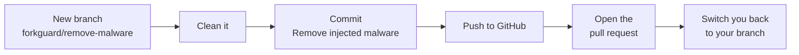

# Getting started with forkguard

This guide takes you from zero to fully protected, one step at a time. No security background needed. Read it top to bottom the first time, then jump back to any section when you need it.

## Contents

1. [What forkguard does](#1-what-forkguard-does)
2. [Install it](#2-install-it)
3. [Check a project on your computer](#3-check-a-project-on-your-computer)
4. [Check a GitHub repo before you clone it](#4-check-a-github-repo-before-you-clone-it)
5. [Check every repo you own](#5-check-every-repo-you-own)
6. [Read the results](#6-read-the-results)
7. [Clean a project](#7-clean-a-project)
8. [Fix it on GitHub with a pull request](#8-fix-it-on-github-with-a-pull-request)
9. [Turn on automatic protection](#9-turn-on-automatic-protection)
10. [Add it to GitHub Actions](#10-add-it-to-github-actions)
11. [Found something? Do this next](#11-found-something-do-this-next)
12. [Troubleshooting](#12-troubleshooting)
13. [Cheat sheet](#13-cheat-sheet)

---

## 1. What forkguard does

Some malware hides inside ordinary looking repos. Three things make it dangerous:

- **It is invisible.** The code sits after hundreds of spaces at the end of a normal line, so your editor shows nothing unless you scroll far to the right.
- **It runs on its own.** It starts the moment you open the folder in VS Code, or type `npm install` or `npm run dev`.
- **It spreads.** It steals your GitHub token and uses it to quietly rewrite commits in every repo you can push to.

forkguard looks for every trick this malware uses, **before** anything runs. If it finds something, it can clean it up, both on your computer and on GitHub.

It never runs code from the project it checks, and it never uploads your code anywhere.

---

## 2. Install it

You need two things on your computer:

- **Node.js 18 or newer.** Get it from [nodejs.org](https://nodejs.org).
- **git.** Get it from [git-scm.com](https://git-scm.com).

Check you have them:

```bash
node --version
```

```bash
git --version
```

Now install forkguard:

```bash
npm install -g forkguard
```

The `-g` means "global": you can now type `forkguard` in any folder. Check it worked:

```bash
forkguard --version
```

> **Just want to try it once?** Skip installing and put `npx` in front of any command, like `npx forkguard`. You do need the global install for automatic protection (section 9).

> **"forkguard is not recognized" after installing?** Close your terminal and open a new one.

---

## 3. Check a project on your computer

Open a terminal **inside** the project folder and run:

```bash
forkguard
```

To check a folder without moving into it, give the path:

```bash
forkguard path/to/project
```

A clean project looks like this:

```text
forkguard  my-app looks clean (433 files checked)
```

If you see that, you are good to go. If you see a list instead, jump to [section 6](#6-read-the-results).

> **Tip for your own repos:** run `git pull` first. This malware gets into GitHub, not your laptop, so your local copy can look clean while GitHub has the infected version.

---

## 4. Check a GitHub repo before you clone it

This is the safest way to look at a repo you do not know yet, like a coding test from a recruiter or a project you want to fork. You do not even need to clone it.

```bash
forkguard someone/their-repo
```

A full link works too:

```bash
forkguard https://github.com/someone/their-repo
```

What happens:

1. forkguard downloads the latest commit of **every branch** into a temporary folder.
2. It does **not** unpack the files. They stay packed inside git, so nothing from the repo lands on your disk as a real file.
3. It checks everything, then deletes the temporary folder.

Result:

```text
forkguard  someone/their-repo looks clean (3 branches checked)
```

Only clone and open it if it says **looks clean**. If it shows anything HIGH, do not clone it, do not open it and do not run it.

> Works for private repos too, as long as you are logged in to GitHub on this computer. The easiest way is `gh auth login`.

---

## 5. Check every repo you own

One command checks all of your GitHub repos, every branch.

First, log in to GitHub once. Install the [GitHub CLI](https://cli.github.com), then:

```bash
gh auth login
```

Then:

```bash
forkguard --mine
```

You get one line per repo while it works:

```text
forkguard  checking 54 of your repos on GitHub, every branch

  clean            you/portfolio
  INFECTED         you/old-project
  worth a look     you/side-project
  ...

  54 repos checked: 52 clean, 1 infected
```

Then the full details for every repo that needs attention. About 50 repos takes a minute or two.

> Do this once now, and again whenever you hear about a new attack. It is the fastest way to know your whole GitHub is clean.

---

## 6. Read the results

When forkguard finds something, you get a list:

```text
forkguard  my-app

  HIGH  init                Code hidden after 776 blank spaces on line 35
  HIGH  package.json        "dev" runs a hidden file called init before your real command
  MED   .gitignore          Hides config.bat, a file this malware drops

  3 problems found. Do not run npm install, npm run dev or open this folder in VS Code yet.
```

Each line has three parts:

1. **The level:** how serious it is.
2. **The file:** where it is.
3. **The message:** what is wrong, in plain words.

| Level | What it means | What to do |
| --- | --- | --- |
| **HIGH** | Dangerous. It can run by itself and steal from you. | Do not install, run or open the project. Clean it first. |
| **MED** | Worth a look. It does not run by itself. | Read it and decide. Most can be fixed with `forkguard fix`. |

Want to know what each message means? The [How it works](how-it-works.md#2-what-it-checks) page lists every check.

---

## 7. Clean a project

Inside the project folder, run:

```bash
forkguard fix
```

You will see what changed:

```text
forkguard  cleaning my-app

  done  init                deleted
  done  package.json        cleaned
  done  postcss.config.mjs  restored your original from git history

  Clean now. Review with "git diff", then commit.
```

What each word means:

| Word | What happened |
| --- | --- |
| **deleted** | The file was nothing but malware, so it is gone |
| **cleaned** | The file is yours. Only the bad part was removed. Your code is untouched. |
| **restored your original from git history** | forkguard found the clean version you wrote before the attack and put it back exactly |

Now look at what changed and save it:

```bash
git diff
```

```bash
git add -A
git commit -m "Remove injected malware"
```

> **Not a git repo?** forkguard asks before changing anything, because there is no way to undo it.

> **Some things are not fixed automatically:** a known bad npm package, a risky install script, or an infected npm on your computer. forkguard tells you what to do for each.

---

## 8. Fix it on GitHub with a pull request

`forkguard fix` cleans your computer. `forkguard pr` cleans **GitHub** too, by opening a pull request with the fix. This is what you want when the malware is in a repo on GitHub, which it usually is.

### Before you start

1. **Log in to GitHub.** The easiest way:

   ```bash
   gh auth login
   ```

   No GitHub CLI? A `GITHUB_TOKEN` environment variable works too. Without either, forkguard still pushes the branch and gives you a link to open the pull request yourself.

2. **Commit or stash any work in progress.** forkguard refuses to run with uncommitted changes, so your work never ends up mixed into the fix:

   ```bash
   git stash
   ```

### Fix your own repo

Inside the project folder:

```bash
forkguard pr
```

Here is everything it does, in order:



At the end you get a link. Open it, look at the changes, and click **Merge**. Then bring your stashed work back:

```bash
git stash pop
```

### Fix the repo you forked from

If you forked someone's project and **their** repo has the malware, send them the fix:

```bash
forkguard pr --upstream
```

forkguard builds the fix on top of the original repo, not your fork. That way the pull request holds only the fix, and never carries anything bad from your fork along with it.

| You want to... | Run |
| --- | --- |
| Clean your own repo on GitHub | `forkguard pr` |
| Send the fix to the repo you forked from | `forkguard pr --upstream` |

---

## 9. Turn on automatic protection

This is the part that protects you every day without you thinking about it. You need forkguard installed globally (section 2).

Run once:

```bash
forkguard setup
```

It will ask:

```text
Also stop VS Code from running tasks by itself when you open a folder? (Y/n)
```

Press **Enter** for yes. That is the setting this malware uses to start the moment you open a folder.

Then **close your terminal and open a new one**. From now on:

| When you run... | forkguard... |
| --- | --- |
| `npm install`, `npm run dev`, `npm start`, `npm test`, `npm run build` | checks first, and **stops the command** if the project is dangerous |
| the same with `pnpm`, `yarn` or `bun` | does the same |
| `git clone`, `git pull`, `git merge`, `git checkout`, `git switch` | checks what you just pulled in and warns you |
| anything else, like `npm --version` or `git status` | runs normally, no check |

When everything is clean, you see nothing at all. It only speaks up when something is wrong. This is what it looks like when it stops something:

```text
forkguard  my-app

  HIGH  init  Code hidden after 776 blank spaces on line 35

  Stopped "npm install" so nothing in this project runs.
```

### Run something anyway, just once

PowerShell:

```powershell
$env:FORKGUARD_SKIP='1'; npm install
```

Git Bash, macOS or Linux:

```bash
FORKGUARD_SKIP=1 npm install
```

### Turn it off

```bash
forkguard setup --remove
```

Open a new terminal and it is gone.

> Works with PowerShell, Git Bash, bash and zsh. Setup only adds one clearly marked block to your shell profile, and `--remove` takes it out again.

---

## 10. Add it to GitHub Actions

Your computer is protected. Now protect GitHub too, so every push gets checked even when you are not around.

Create `.github/workflows/forkguard.yml` in your repo:

```yaml
name: forkguard
on: [push, pull_request]

permissions:
  contents: read

jobs:
  check:
    runs-on: ubuntu-latest
    steps:
      - uses: actions/checkout@v4
      - uses: PRODHOSH/forkguard@v0.3.1
```

Commit and push it. If malware ever lands, the build turns red and GitHub emails you.

The [GitHub Action guide](github-action.md) covers everything else: opening the fix as a pull request, nightly checks, monorepos and more.

---

## 11. Found something? Do this next

The order matters.

1. **Do not** run `npm install` or `npm run dev`, and do not open the folder in VS Code.
2. **Clean it** with `forkguard fix`, or `forkguard pr` to clean GitHub too.
3. **From another device**, change your passwords and keys: GitHub tokens, SSH keys, your npm token, cloud keys, and everything in your `.env` files. The malware steals these, so assume they are known.
4. **Stop history rewrites.** In your GitHub repo go to **Settings**, then **Rules**, then **Rulesets**, and block force pushes on your main branch.
5. **If forkguard says npm itself is infected,** reinstall Node.js from [nodejs.org](https://nodejs.org) before running npm again.
6. **Check everything else:** run `forkguard --mine` to check all your repos.
7. **Run a full antivirus scan,** and tell anyone else who works on the same repos.

---

## 12. Troubleshooting

**"forkguard is not recognized" or "command not found"**
Install it globally with `npm install -g forkguard`, then open a new terminal.

**Automatic checks do not run after setup**
Close the terminal and open a new one. Setup only takes effect in new terminals.

**Windows Defender says "Unauthorized changes blocked" during setup**
Windows Defender's Controlled Folder Access feature protects your `Documents` folder from being edited by outside tools. You do not need to change Windows Defender settings:
1. Run `forkguard setup --print` to view the hook block.
2. In PowerShell, run `notepad $PROFILE`.
3. Paste the block at the bottom and save.

**"Log in first so forkguard can list your repos"**
Run `gh auth login`, or set a `GITHUB_TOKEN`. Needed for `--mine`.

**"could not download" when checking a link**
Check the link is right. For a private repo, make sure you are logged in with `gh auth login`.

**"You have uncommitted changes"**
`forkguard pr` needs a clean working tree. Run `git stash`, then try again, then `git stash pop`.

**"The origin remote is not on GitHub"**
`forkguard pr` only works with repos on GitHub. Use `forkguard fix` instead.

**It flagged something that is fine**
Skip it once with `FORKGUARD_SKIP=1`, then [report a false alarm](https://github.com/PRODHOSH/forkguard/issues/new?template=false-alarm.yml) so the rule gets better.

**It missed something**
[Tell us what it looked like](https://github.com/PRODHOSH/forkguard/issues/new?template=missed-malware.yml). Please describe it rather than pasting the malicious code.

---

## 13. Cheat sheet

| I want to... | Run |
| --- | --- |
| Check this folder | `forkguard` |
| Check another folder | `forkguard path/to/project` |
| Check a GitHub repo without cloning | `forkguard owner/repo` |
| Check all my repos on GitHub | `forkguard --mine` |
| Clean this folder | `forkguard fix` |
| Clean it on GitHub with a pull request | `forkguard pr` |
| Send the fix to the repo I forked from | `forkguard pr --upstream` |
| Check automatically before npm and after git | `forkguard setup` |
| Turn automatic checks off | `forkguard setup --remove` |
| Skip the check once | `FORKGUARD_SKIP=1 npm install` |
| Get results as JSON | `forkguard --json` |
| See the version | `forkguard --version` |

Every command in full detail: [Commands reference](commands.md). Under the hood: [How it works](how-it-works.md).
