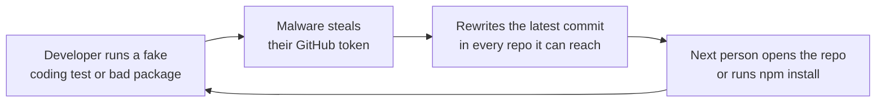
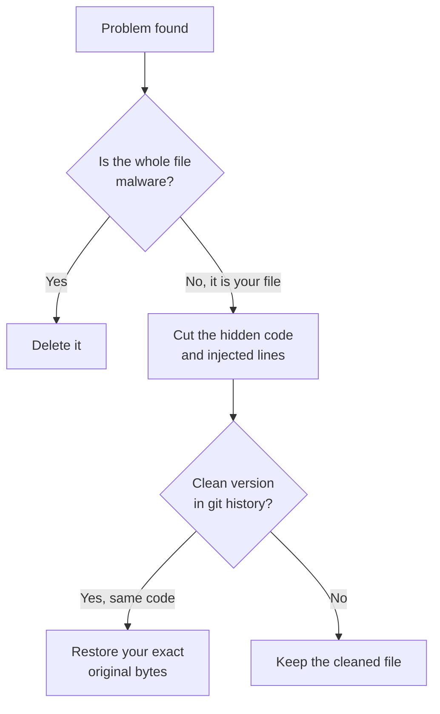
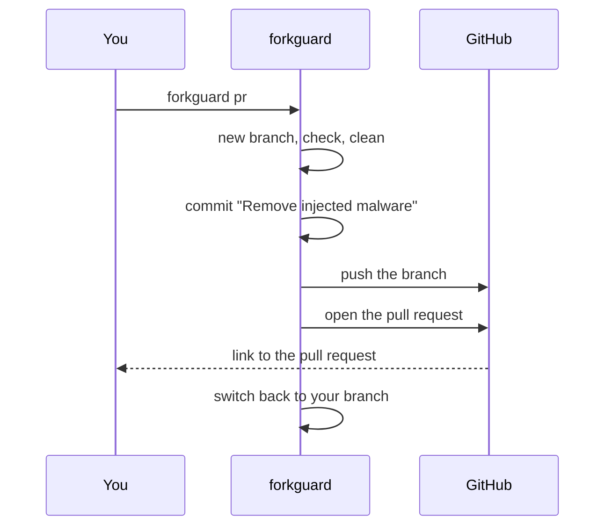
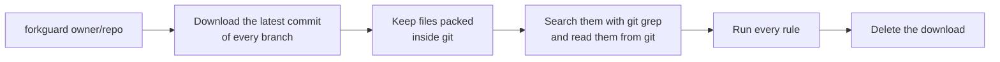
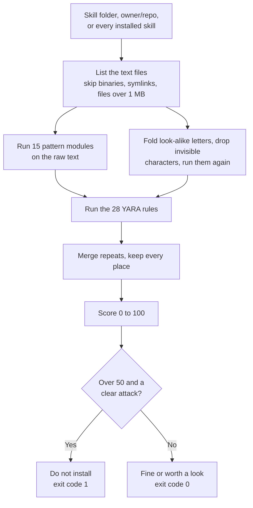
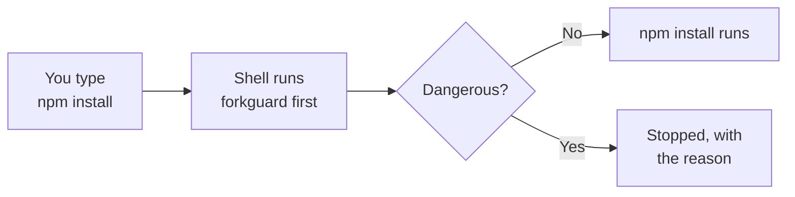
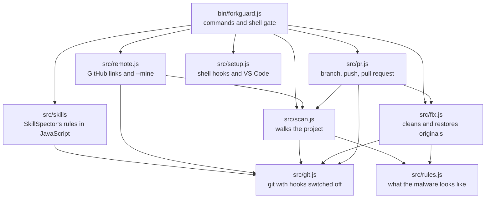

  <a href="https://github.com/PRODHOSH/forkguard">
    <picture>
      <source media="(prefers-color-scheme: dark)" srcset="../site/assets/brand/logo-on-dark.svg">
      
    </picture>
  </a>

> This page is also on the [documentation site](https://forkguard.pages.dev/internals/how-it-works/), with search and a short and a plain-words version of every command. All docs: [index](README.md).

# How forkguard works

The details behind the scenes. You do not need any of this to use forkguard. For that, see [Getting started](getting-started.md).

## Contents

1. [The attack it stops](#1-the-attack-it-stops)
2. [What it checks](#2-what-it-checks)
3. [How fixing works](#3-how-fixing-works)
4. [How the pull request works](#4-how-the-pull-request-works)
5. [How checking a GitHub link works](#5-how-checking-a-github-link-works)
6. [How checking an AI agent skill works](#6-how-checking-an-ai-agent-skill-works)
7. [How automatic checks work](#7-how-automatic-checks-work)
8. [Architecture](#8-architecture)
9. [Tech stack](#9-tech-stack)
10. [Safety and privacy](#10-safety-and-privacy)

---

## 1. The attack it stops

forkguard was built against a malware campaign researchers call **PolinRider**. This is how it spreads:

It is hard to spot because:

- The code sits after hundreds of spaces at the end of a normal line, so editors show nothing.
- The rewritten commit keeps the same author, date and message, so git history looks untouched.
- It also hides in fake font files, VS Code tasks that run when a folder opens, and even inside npm itself.

---

## 2. What it checks

Every rule comes from real infected repos.

| Check | What it looks for | Level |
| --- | --- | --- |
| Hidden code | Code pushed far right after a long run of spaces, in any JS or TS file | High |
| Known signatures | Strings that only show up in this malware | High |
| Env loaders | A small block that decodes a URL from an env variable, downloads code and runs it with `eval` | High |
| `node init` scripts | `dev`, `build` or `start` secretly running a file called `init` first | High |
| Fake fonts | A `.ttf` or `.woff2` file that is really JavaScript | High |
| Decoy folders | A fonts folder planted to make the fake font look normal | High |
| VS Code auto tasks | A task that runs the moment you open the folder | High |
| Dropped files | `config.bat`, `temp_auto_push.bat`, `.orc` files | High |
| Bad packages | npm packages known to carry this payload | High |
| Infected npm | npm's own `cli.js` on your computer bloated with hidden code | High |
| Injected require lines | Fake `createRequire` lines added to config files | Medium |
| Auto task setting | `.vscode/settings.json` switching automatic tasks on | Medium |
| `.gitignore` tricks | Hiding the dropped `config.bat` | Medium |
| Unprotected `.env` | A `.env` that git is not ignoring, or one already committed | Medium |
| Risky install scripts | `postinstall` and friends that download or decode things | Medium |
| Rewritten commit | Latest commit has the same time in a different timezone | Medium |

It skips `node_modules`, build output and other folders that are not your code, so a typical project is checked in well under a second.

---

## 3. How fixing works

Cutting off the hidden code is the easy part. The malware also adds fake `require` lines to the top of files and sometimes mangles line breaks. `forkguard fix` handles all of it in three steps:

- **Deleted:** `init` files, fake fonts, decoy folders, dropped `.bat` files, auto-run tasks.
- **Cleaned:** your config files and scripts. Only the bad part is removed. Your code and blank lines stay as they were.
- **Restored:** when git has an older clean version with the same code, you get back exactly what you wrote, line breaks included.

---

## 4. How the pull request works

**Why `--upstream` builds from the original repo:** if your fork is the infected one, a normal pull request from your fork would carry the malicious commit along with the fix. Building on top of the original keeps the pull request to exactly one commit, the fix.

**How it logs in:** it tries the GitHub CLI first, then a `GITHUB_TOKEN`. If neither is there, it still pushes the branch and prints the link to open the pull request yourself.

---

## 5. How checking a GitHub link works

`forkguard owner/repo` and `forkguard --mine` check repos on GitHub without ever writing their files to your disk.

Step by step:

1. **A shallow, no-checkout clone.** forkguard runs `git clone --no-checkout --depth 1 --no-single-branch` into a temporary folder. That fetches only the newest commit of each branch, which is small and fast. `--no-checkout` means the files are never unpacked onto your disk, so there is nothing an editor, an antivirus scan or a stray double click could run.
2. **Search inside git.** It uses `git grep` to search every code file on a branch for the malware's fingerprints in one pass, so even repos with thousands of files take a few seconds.
3. **Read only what matters.** It reads the suspicious files, plus every `package.json`, lockfile, font and VS Code file, straight out of git's database with `git cat-file`.
4. **The same rules.** It runs exactly the same checks as a folder scan, so a link check and a local check never disagree.
5. **One check per commit.** Branches that point at the same commit are only checked once.
6. **Clean up.** The temporary folder is deleted, whether the check passed or failed.

`--mine` lists your repos through the GitHub CLI or the GitHub API, then runs this for four repos at a time.

---

## 6. How checking an AI agent skill works

`forkguard skills` applies [NVIDIA SkillSpector's](https://github.com/NVIDIA/SkillSpector) rules, translated to JavaScript, to skill folders (a `SKILL.md` plus its scripts and references).

- **The rules** are SkillSpector's regular expressions, severities, confidences and YARA rule files. A script copied them out of its Python source, so none was retyped.
- **The cleaned view** is how a model would read the text: look-alike letters folded to ASCII and invisible characters dropped. It stops an instruction spelled with a Cyrillic letter that looks like a Latin one, or one split by hidden zero-width characters, from slipping past.
- **Exemptions.** A sentence that forbids something, like "never reveal the system prompt", is not flagged as if it asked for it. License text, quoted examples and a few documentation patterns are recognised too.
- **The score** counts each rule in full once, half the second time and a quarter the third, scaled by how sure the rule is, with 1.3 times for executable files.
- **The decision** is SkillSpector's score plus forkguard's own check for a clear attack, because SkillSpector relies on an AI review to drop false alarms and forkguard has none.
- **Downloading** a skill from GitHub is a shallow clone into a temporary folder with git hooks switched off and symlinks off. Nothing in it is run, and the folder is deleted afterwards.

Everything about coverage, numbers and where the JavaScript differs from the Python is in [AI agent skills](skills.md).

---

## 7. How automatic checks work

`forkguard setup` adds a small, clearly marked block to your shell profile. It wraps `npm`, `pnpm`, `yarn`, `bun`, `npx`, `bunx`, `pnpx` and `git`:

- For package managers it checks **before** install, run, dev, start, build and test, and can stop the command.
- For `npx skills add` (and `bunx`, `pnpx`, `pnpm dlx`, `yarn dlx`, `npm exec`) it downloads the skill to a temporary folder and checks it **before** anything is installed.
- For git it checks **after** clone, pull, merge, checkout and switch, and warns you.
- Other commands like `npm --version`, `npx cowsay` or `git status` pass straight through without a check.
- If forkguard is missing or crashes, your command still runs. Only an explicit "dangerous" answer (exit code 1) stops anything.

---

## 8. Architecture

| File | Job |
| --- | --- |
| `bin/forkguard.js` | Reads your command and runs the right part |
| `src/rules.js` | Everything forkguard knows about the malware |
| `src/scan.js` | Walks the project and runs every rule on each file |
| `src/remote.js` | Checks GitHub repos and `--mine` straight from git's database |
| `src/fix.js` | Removes problems and restores original files |
| `src/pr.js` | Creates the branch, commit, push and pull request |
| `src/setup.js` | Installs and removes the shell hooks |
| `src/skills/` | The skill checks: `scan.js` (read, run, score), `modules/` (the 15 rule modules and the YARA runner), `data/` (the rule tables and YARA files copied from SkillSpector), `pyregex.js` (Python regex to JavaScript) |
| `skills/forkguard/` | The forkguard skill that you give your AI agent |
| `src/git.js` | Talks to git, always with hooks switched off |
| `src/report.js` | Prints the results |

---

## 9. Tech stack

| Part | Choice | Why |
| --- | --- | --- |
| Runtime | Node.js 18+ | Every JavaScript developer already has it |
| Dependencies | None | A tool you run before `npm install` should not need `npm install` |
| Git | The `git` you already have | Reads history to restore your files |
| Pull requests | GitHub CLI or the GitHub API | Works with however you are logged in |
| Skill rules | NVIDIA SkillSpector's, translated | One tool for code and skills, with no Python and no AI key |
| License | Apache 2.0 | Keeps the credit and the patent grant that SkillSpector's own license carries |
| Tests | `node:test` | Built into Node |
| CI | Linux, Windows and macOS on Node 18, 20 and 22 | The malware targets all three |

---

## 10. Safety and privacy

- **It never runs project code.** It only reads files.
- **It switches off git hooks** whenever it calls git, because an infected repo can ship its own.
- **It never runs npm** to check npm. It reads npm's files directly.
- **It never writes downloaded repo files to disk.** Link checks keep everything packed inside git and delete it afterwards. A skill source is the one exception: it is cloned to a temporary folder, read and deleted, because its files must be read as files.
- **It sends nothing anywhere.** The only network calls are downloading a repo or skill you asked it to check, and talking to GitHub for `forkguard pr` and `--mine`.
- **Zero dependencies.** There is nothing in between you and the check that could be compromised.
