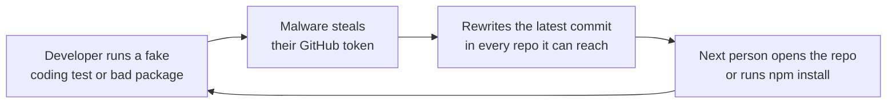
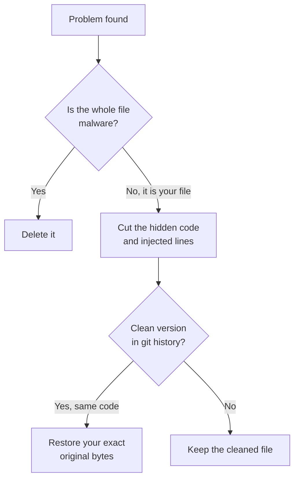
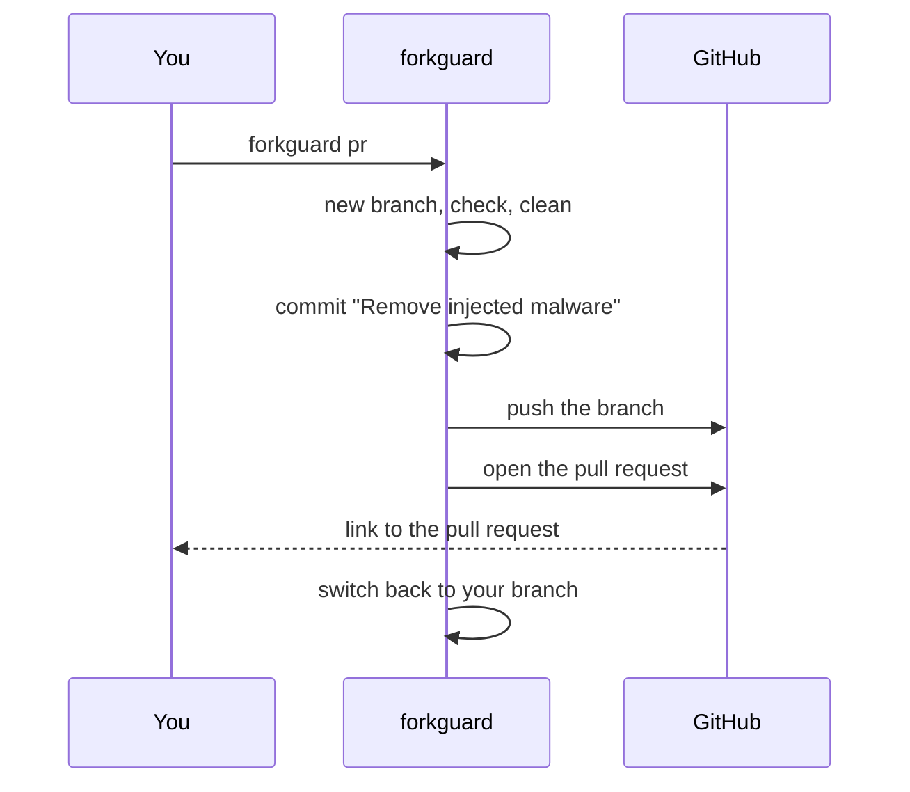
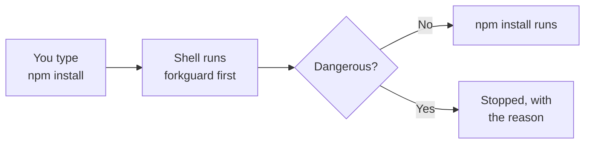
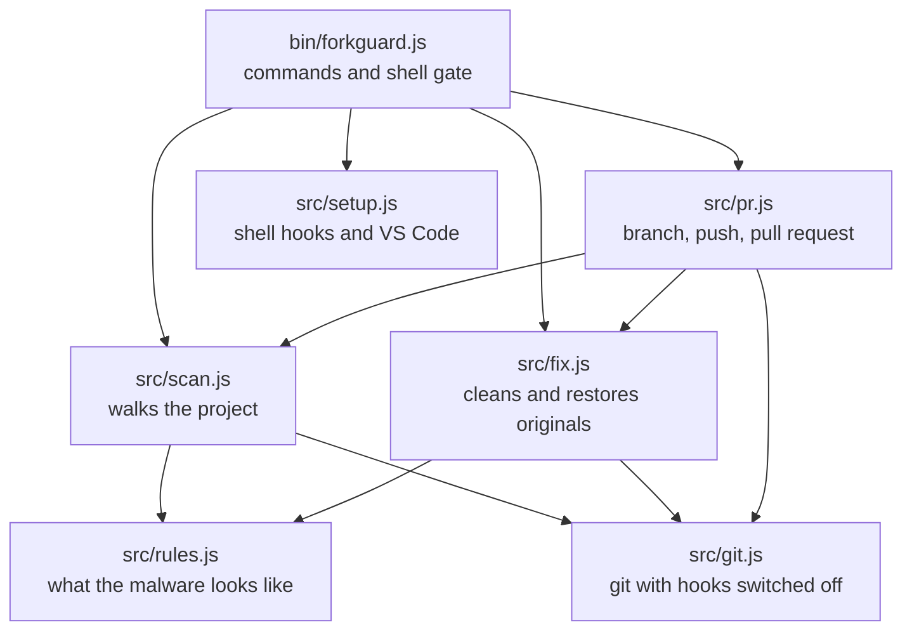

# How forkguard works

The details behind the scenes. You do not need any of this to use forkguard. For that, see [Getting started](getting-started.md).

## Contents

1. [The attack it stops](#1-the-attack-it-stops)
2. [What it checks](#2-what-it-checks)
3. [How fixing works](#3-how-fixing-works)
4. [How the pull request works](#4-how-the-pull-request-works)
5. [How automatic checks work](#5-how-automatic-checks-work)
6. [Architecture](#6-architecture)
7. [Tech stack](#7-tech-stack)
8. [Safety and privacy](#8-safety-and-privacy)

---

## 1. The attack it stops

forkguard was built against a malware campaign researchers call **PolinRider**. This is how it spreads:

It is hard to spot because:

- The code sits after hundreds of spaces at the end of a normal line, so editors show nothing.
- The rewritten commit keeps the same author, date and message, so git history looks untouched.
- It also hides in fake font files, VS Code tasks that run when a folder opens, and even inside npm itself.

---

## 2. What it checks

Every rule comes from real infected repos.

| Check | What it looks for | Level |
| --- | --- | --- |
| Hidden code | Code pushed far right after a long run of spaces, in any JS or TS file | High |
| Known signatures | Strings that only show up in this malware | High |
| `node init` scripts | `dev`, `build` or `start` secretly running a file called `init` first | High |
| Fake fonts | A `.ttf` or `.woff2` file that is really JavaScript | High |
| Decoy folders | A fonts folder planted to make the fake font look normal | High |
| VS Code auto tasks | A task that runs the moment you open the folder | High |
| Dropped files | `config.bat`, `temp_auto_push.bat`, `.orc` files | High |
| Bad packages | npm packages known to carry this payload | High |
| Infected npm | npm's own `cli.js` on your computer bloated with hidden code | High |
| Injected require lines | Fake `createRequire` lines added to config files | Medium |
| Auto task setting | `.vscode/settings.json` switching automatic tasks on | Medium |
| `.gitignore` tricks | Hiding the dropped `config.bat` | Medium |
| Unprotected `.env` | A `.env` that git is not ignoring, or one already committed | Medium |
| Risky install scripts | `postinstall` and friends that download or decode things | Medium |
| Rewritten commit | Latest commit has the same time in a different timezone | Medium |

It skips `node_modules`, build output and other folders that are not your code, so a typical project is checked in well under a second.

---

## 3. How fixing works

Cutting off the hidden code is the easy part. The malware also adds fake `require` lines to the top of files and sometimes mangles line breaks. `forkguard fix` handles all of it in three steps:

- **Deleted:** `init` files, fake fonts, decoy folders, dropped `.bat` files, auto-run tasks.
- **Cleaned:** your config files and scripts. Only the bad part is removed. Your code and blank lines stay as they were.
- **Restored:** when git has an older clean version with the same code, you get back exactly what you wrote, line breaks included.

---

## 4. How the pull request works

**Why `--upstream` builds from the original repo:** if your fork is the infected one, a normal pull request from your fork would carry the malicious commit along with the fix. Building on top of the original keeps the pull request to exactly one commit, the fix.

**How it logs in:** it tries the GitHub CLI first, then a `GITHUB_TOKEN`. If neither is there, it still pushes the branch and prints the link to open the pull request yourself.

---

## 5. How automatic checks work

`forkguard setup` adds a small, clearly marked block to your shell profile. It wraps `npm`, `pnpm`, `yarn`, `bun` and `git`:

- For package managers it checks **before** install, run, dev, start, build and test, and can stop the command.
- For git it checks **after** clone, pull, merge, checkout and switch, and warns you.
- Other commands like `npm --version` or `git status` pass straight through without a check.

---

## 6. Architecture

| File | Job |
| --- | --- |
| `bin/forkguard.js` | Reads your command and runs the right part |
| `src/rules.js` | Everything forkguard knows about the malware |
| `src/scan.js` | Walks the project and collects problems |
| `src/fix.js` | Removes problems and restores original files |
| `src/pr.js` | Creates the branch, commit, push and pull request |
| `src/setup.js` | Installs and removes the shell hooks |
| `src/git.js` | Talks to git, always with hooks switched off |
| `src/report.js` | Prints the results |

---

## 7. Tech stack

| Part | Choice | Why |
| --- | --- | --- |
| Runtime | Node.js 18+ | Every JavaScript developer already has it |
| Dependencies | None | A tool you run before `npm install` should not need `npm install` |
| Git | The `git` you already have | Reads history to restore your files |
| Pull requests | GitHub CLI or the GitHub API | Works with however you are logged in |
| Tests | `node:test` | Built into Node |
| CI | Linux, Windows and macOS on Node 18, 20 and 22 | The malware targets all three |

---

## 8. Safety and privacy

- **It never runs project code.** It only reads files.
- **It switches off git hooks** whenever it calls git, because an infected repo can ship its own.
- **It never runs npm** to check npm. It reads npm's files directly.
- **It sends nothing anywhere.** The only network calls are from `forkguard pr`, to GitHub, when you ask for it.
- **Zero dependencies.** There is nothing in between you and the check that could be compromised.
